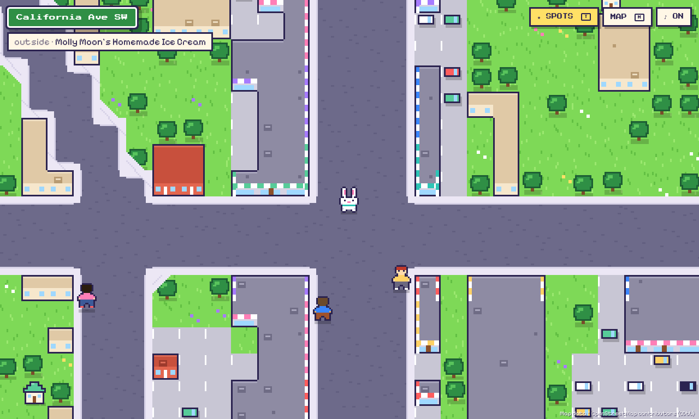
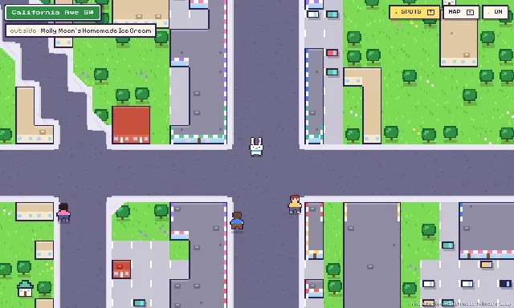
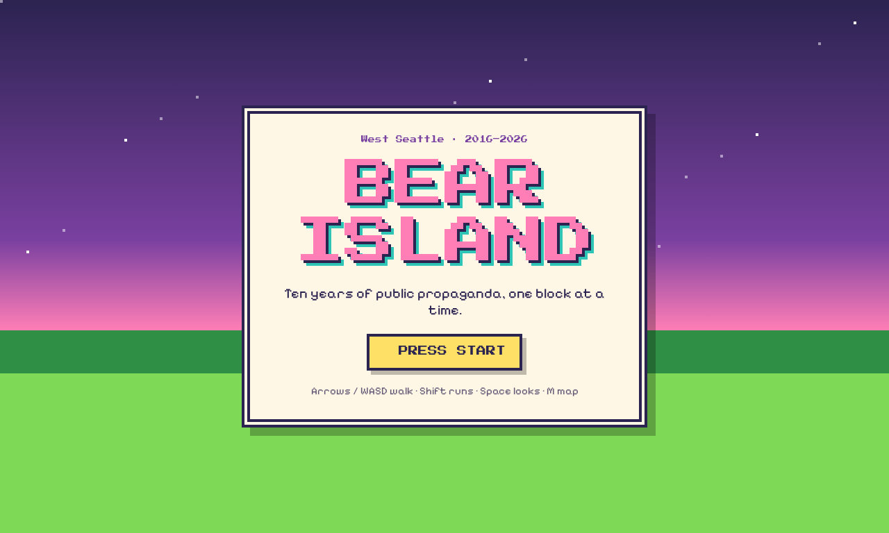
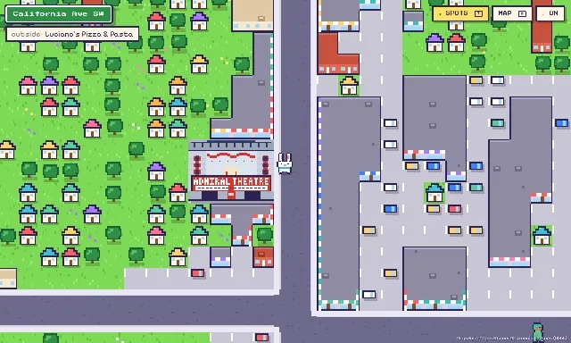
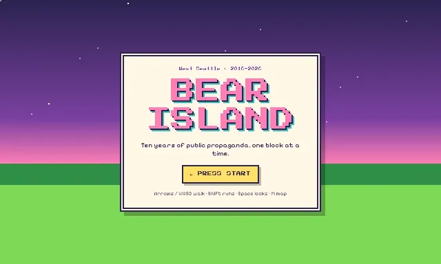

# The Garden in Sound: how the island grew

Every change that went live on [gardeninsound.website](https://gardeninsound.website), newest first, with the wish that started it, what was made, who made it, and how the spot looked before and after. Written automatically by [`.github/workflows/story.yml`](https://github.com/gardeninsound/map/blob/main/.github/workflows/story.yml) when a change merges; the raw records are in `changes/` and `wishes/`, and `story.json` indexes them all.

**5** changes · **12** wishes from visitors, **0** answered · **1** still waiting

---

### Oct 18, 2026 · Junction busker with distance-faded chiptune music ([64e2728](https://github.com/gardeninsound/map/commit/64e2728bb61d6862674ceaf5a45ed863ba6ac5fb))

- Keyboard player on the curb outside Easy Street, rocking on the beat
  with musical notes floating up
- Three original songs synthesized via Web Audio; volume follows your
  distance and fades out past ~130 m, hushed inside art scenes, honors mute
- Talkable, with song-title chatter

Co-Authored-By: Claude Opus 5.5 &lt;noreply@anthropic.com&gt;

| before | after |
|---|---|
|  |  |

vlandham with Claude Code · 9 files, +329 −3 · characters & map life, ui, words & content, docs · [record](changes/2026-10-18-64e2728-junction-busker-with-distance-faded-chip/entry.json)

---

### Oct 18, 2026 · Compass, first-visit arrow, octilinear roads, Seven+ Stories walk ([23a878f](https://github.com/gardeninsound/map/commit/23a878f9a788dcc46da6a5519f029192835b88df))

- HUD compass points to the nearest art spot with a scene
- New visitors get a flashing arrow toward it after Mike's welcome
- Roads snapped to 0/45/90° with half-tile curb cuts: clean diagonals
- Seven+ Stories: first-person three.js walk of the lot at
  4731 40th Ave SW, signs standing in the field, close-up reading

Co-Authored-By: Claude Opus 5.5 &lt;noreply@anthropic.com&gt;

| before | after |
|---|---|
|  |  |

vlandham with Claude Code · 18 files, +960 −34 · characters & map life, scenes & games, ui, words & content, docs, tools · [record](changes/2026-10-18-23a878f-compass-first-visit-arrow-octilinear-roa/entry.json)

---

### Oct 18, 2026 · Wider, straighter roads with clean intersections ([14bb1a4](https://github.com/gardeninsound/map/commit/14bb1a4d1a6a36ef02174eec5326e5191056e0b3))

- California 4 tiles, other streets 3; diagonals widened to match
- Chain each street's OSM ways, cut at intersections, snap near-axis
  runs to tile centres so straight streets stay straight
- Drop turn ramps and short unnamed stubs; report unreachable streets
- 45° curb cuts at corners and staircase notches
- More review spots (Erskine Way, California & Admiral)

Co-Authored-By: Claude Opus 5.5 &lt;noreply@anthropic.com&gt;

| before · the Junction, where everyone starts | after |
|---|---|
|  |  |

vlandham with Claude Code · 6 files, +198 −23 · characters & map life, docs, tools · [record](changes/2026-10-18-14bb1a4-wider-straighter-roads-with-clean-inters/entry.json)

---

### Oct 18, 2026 · Map cleanup, landmarks, and art-spot shortcuts ([23e2785](https://github.com/gardeninsound/map/commit/23e2785b557389db7f90d6f38ece8204a568145a))

- Roads: one fixed width per street (scripts/map-config.mjs), simplified
  polylines, constant-width bands; arterials 2 tiles to match 12 m lots
- Sidewalks drawn on road edge tiles so they're identical everywhere
- Landmarks sheet (content/landmarks.csv) geocoded and placed beside the
  street: 76 station with the mural wall, Admiral Theatre
- Gas-station wall spot moved to the 76 at 4001 California Ave SW
- SPOTS menu (T): jump to any art spot or straight into its scene
- npm run map:review: repeatable before/after map screenshots

Co-Authored-By: Claude Opus 5.5 &lt;noreply@anthropic.com&gt;

| before | after |
|---|---|
|  |  |

| before | after |
|---|---|
|  |  |

vlandham with Claude Code · 24 files, +704 −85 · map pipeline, characters & map life, ui, words & content, docs, tools · [record](changes/2026-10-18-23e2785-map-cleanup-landmarks-and-art-spot-short/entry.json)

---

### Oct 18, 2026 · Bear Island map: pixel West Seattle overworld with first art scenes ([8066597](https://github.com/gardeninsound/map/commit/806659730c751aabf719c285a3b732ad3c7af377))

- OSM-generated West Seattle (12 m tiles): real streets, footprint houses,
  storefronts, parks with labels; walkable arterials incl. bridges
- Rabbit avatar, wandering neighbors, Mike dialog, minimap, touch controls
- Art spots from content/places.csv (geocoded via Nominatim)
- Scenes: gas-station wall flipbook, 3D paintable Lulu cup (three.js)
- Processed art kept out of git; regenerate with npm run images

Co-Authored-By: Claude Opus 5.5 &lt;noreply@anthropic.com&gt;

vlandham with Claude Code · 57 files, +12643 −0 · characters & map life, scenes & games, ui, words & content, art & sound, ci, docs, tools · [record](changes/2026-10-18-8066597-bear-island-map-pixel-west-seattle-overw/entry.json)

---

## Wishes still waiting

- Nov 4, 2026: “some little hats the rabits could wear and mini version of us and mst3k people walking around who we could talk to” — zia vallandingham jims kid ([#34](https://github.com/gardeninsound/map/issues/34))
