# The Garden in Sound: how the island grew

Every change that went live on [gardeninsound.website](https://gardeninsound.website), newest first, with the wish that started it, what was made, who made it, and how the spot looked before and after. Written automatically by [`.github/workflows/story.yml`](https://github.com/gardeninsound/map/blob/main/.github/workflows/story.yml) when a change merges; the raw records are in `changes/` and `wishes/`, and `story.json` indexes them all.

**103** changes · **13** wishes from visitors, **11** answered · **1** still waiting

---

### Nov 19, 2026 · Admin: Mike and Jim only (Cloudflare Access) ([#97](https://github.com/gardeninsound/map/pull/97))

**Asked vs made:** As asked. The data behind the page is locked too, not just the page, and the relay checks the login itself as a second lock.

Needs the Access application set up in the Cloudflare dashboard; then ACCESS_TEAM and ACCESS_AUD go in wrangler.jsonc.

Jim · 10 files, +216 −40 · relay, docs · [record](changes/2026-11-19-pr097-admin-mike-and-jim-only-cloudflare-acces/entry.json)

---

### Nov 19, 2026 · Relay: the Web Analytics site tag for /traffic ([#96](https://github.com/gardeninsound/map/pull/96))

**Asked vs made:** As asked.

Jim · 1 files, +1 −1 · relay · [record](changes/2026-11-19-pr096-relay-the-web-analytics-site-tag-for-tra/entry.json)

---

### Nov 19, 2026 · Admin: the whole site's traffic from Cloudflare ([#95](https://github.com/gardeninsound/map/pull/95))

**Asked vs made:** As asked. The numbers come through the relay so the token stays secret, and the card fills in once Web Analytics and the token are set up.

The zone dataset counts every load of the site; the island's own counts only count rabbits who reach the map.

Jim · 11 files, +412 −19 · relay, tools · [record](changes/2026-11-19-pr095-admin-the-whole-sites-traffic-from-cloud/entry.json)

---

### Nov 19, 2026 · Relay: only live-site rabbits count as visits ([#94](https://github.com/gardeninsound/map/pull/94))

**Asked vs made:** Found while deploying the counts (#92). Fixed before any real numbers came in.

Deployed with `cd relay && npm run deploy` after merge.

Jim · 4 files, +21 −7 · relay · [record](changes/2026-11-19-pr094-relay-only-live-site-rabbits-count-as-vi/entry.json)

---

### Nov 19, 2026 · An /admin/ page for Mike and Jim: visitors, open PRs, open items ([#93](https://github.com/gardeninsound/map/pull/93))

**Asked vs made:** As asked: counts first (#92), then this page with the counts, PRs and open items. It's read-only for now. Editing Mike's lines from here would need a Worker that opens PRs.

Jim · 12 files, +598 −6 · docs, tools · [record](changes/2026-11-19-pr093-an-admin-page-for-mike-and-jim-visitors/entry.json)

---

### Nov 19, 2026 · Counts: visits per day, the peak, and what people open ([#92](https://github.com/gardeninsound/map/pull/92))

**Asked vs made:** Asked for stats and visit counts first, ahead of an admin page. Built anonymous daily counts on the relay and a beacon in the game. The admin page that shows them is next.

The relay needs `npm run deploy` for this to start counting.

| before · the Duck Arcade | after |
|---|---|
| 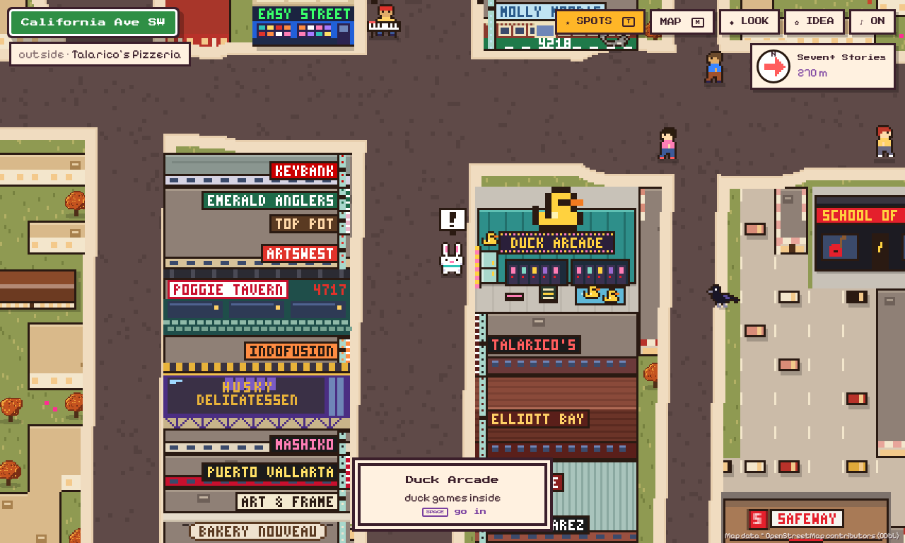 |  |

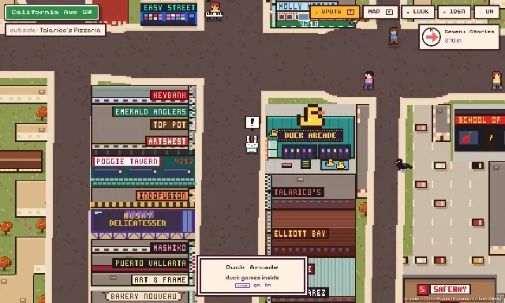

Jim · 12 files, +365 −10 · characters & map life, scenes & games, relay, docs · [record](changes/2026-11-19-pr092-counts-visits-per-day-the-peak-and-what/entry.json)

---

### Nov 18, 2026 · Story page hides behind-the-scenes changes at first ([#91](https://github.com/gardeninsound/map/pull/91))

**Asked vs made:** As asked. Changes come in through a new tag, worked out on its own for plumbing-only changes, and said in the PR for refactors. A button shows them, and links to one still work.

The story log re-tags every change on its next run after this merges, so the page updates then.

Jim · 10 files, +137 −25 · ci, docs, tools · [record](changes/2026-11-18-pr091-story-page-hides-behind-the-scenes-chang/entry.json)

---

### Nov 18, 2026 · Story page: grab the before/after line and drag it ([#89](https://github.com/gardeninsound/map/pull/89))

**Asked vs made:** Asked whether a plugin or a simple implementation could do it. Built it ourselves with pointer events and no new dependency, plus keyboard and touch support. The slider under the photo was removed since the line does its job now.

Jim · 5 files, +112 −20 · docs · [record](changes/2026-11-18-pr089-story-page-grab-the-beforeafter-line-and/entry.json)

---

### Nov 18, 2026 · Fewer critters on screen: 3 crows, 3 gulls, 2 squirrels, a dinosaur now and then ([#88](https://github.com/gardeninsound/map/pull/88))

**Asked vs made:** Asked to tone it down. Crows 7 → 3, gulls 6 → 3, squirrels 5 → 2, and the dinosaurs became an occasional sighting that crosses the screen instead of two that always follow you around.

Counts are constants at the top of each file (`flock.ts`, `dinos.ts`, `plugins/squirrels.ts`), easy to nudge.

| before · the Junction, fewer crows and a dinosaur crossing Alaska now and then | after |
|---|---|
|  |  |

Jim · 7 files, +108 −69 · characters & map life · [record](changes/2026-11-18-pr088-fewer-critters-on-screen-3-crows-3-gulls/entry.json)

---

### Nov 17, 2026 · Plugins change the map through one helper: walkway, solid, oncePerWorld ([#87](https://github.com/gardeninsound/map/pull/87))

**Asked vs made:** Asked to look closer at review item 8 and then build the helper. Made it, moved all five plugins onto it, and fixed Luna Park's duplicate street name.

| before · the Junction, where everyone starts | after |
|---|---|
|  |  |

Jim · 10 files, +136 −57 · city, characters & map life · [record](changes/2026-11-17-pr087-plugins-change-the-map-through-one-helpe/entry.json)

---

### Nov 17, 2026 · Every three.js scene extends PixelScene: one renderer setup, loop, drag and dispose ([#86](https://github.com/gardeninsound/map/pull/86))

**Asked vs made:** Asked for review item 5. Made the shared base class, with no change in how the scenes look or feel.

Each scene also frees all of its textures and listeners when you leave now.

| before · the Giant Whirl, on the shared scene base | after |
|---|---|
| 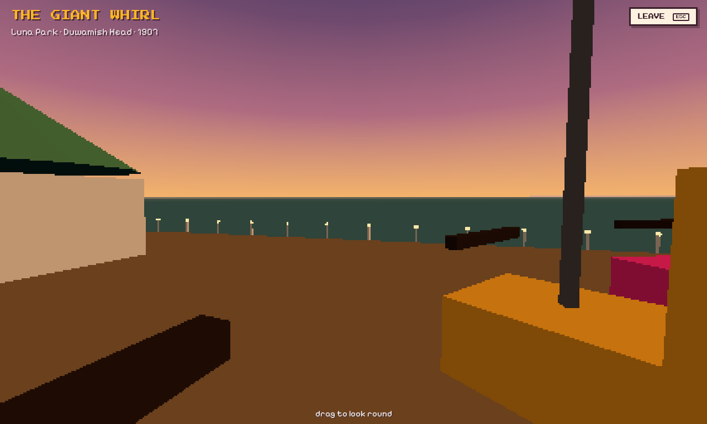 |  |

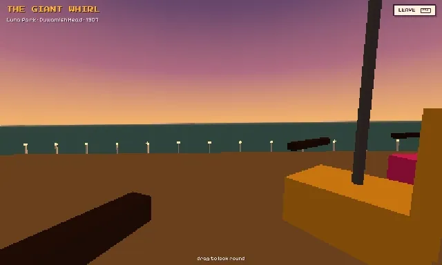

Jim · 9 files, +301 −398 · scenes & games · [record](changes/2026-11-17-pr086-every-threejs-scene-extends-pixelscene-o/entry.json)

---

### Nov 17, 2026 · Arcade games share one shell: useCabinet, BackButton, loadScripts ([#85](https://github.com/gardeninsound/map/pull/85))

**Asked vs made:** Asked for review item 4. Made the shared shell, with no change in how the games play.

| before · Duck on the Moon, through the shared shell | after |
|---|---|
| 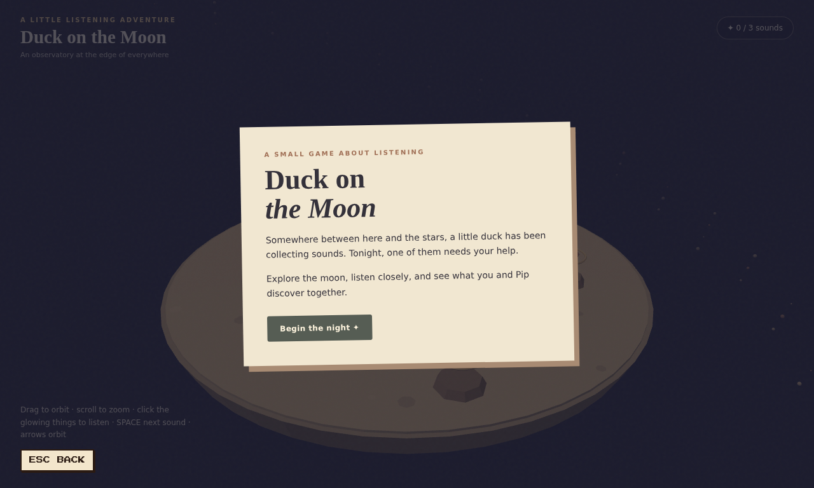 |  |

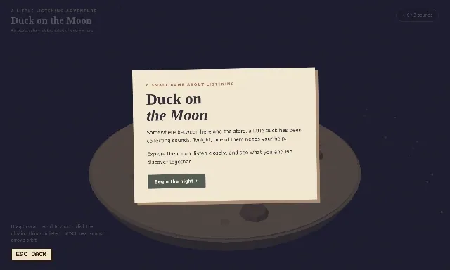

Jim · 7 files, +200 −147 · scenes & games · [record](changes/2026-11-17-pr085-arcade-games-share-one-shell-usecabinet/entry.json)

---

### Nov 17, 2026 · One home each for random numbers, storage, the speech bubble and story dates; fewer kept chunks ([#84](https://github.com/gardeninsound/map/pull/84))

**Asked vs made:** Asked to do review items 1, 2, 3, 6, 7 and 9 together. Made them as described, with no change in how things look.

The next PRs share the arcade cabinets' setup and the 3D scenes' setup.

| before · the Duck Arcade | after |
|---|---|
|  | 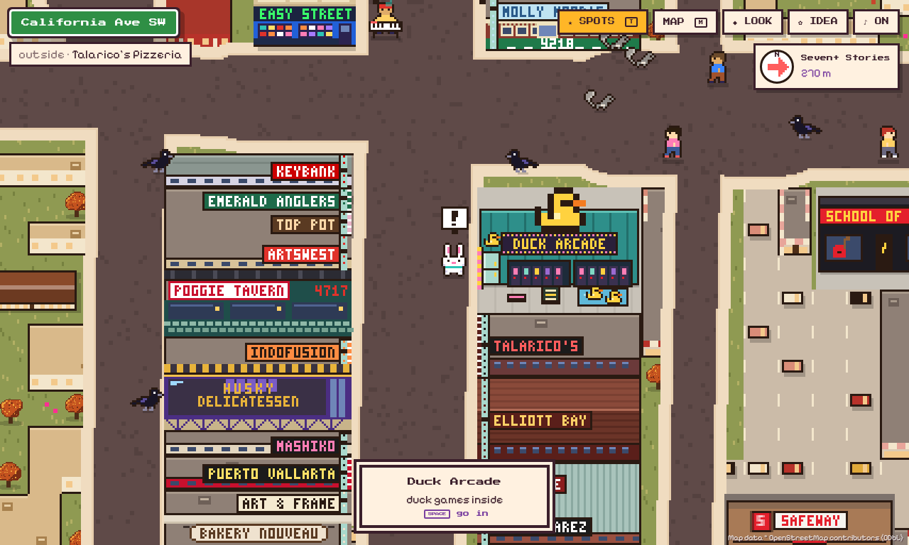 |

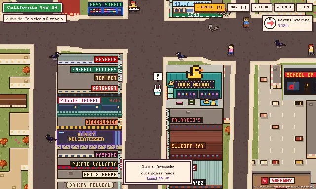

Jim · 29 files, +240 −195 · city, characters & map life, scenes & games, tools · [record](changes/2026-11-17-pr084-one-home-each-for-random-numbers-storage/entry.json)

---

### Nov 16, 2026 · A preview comment that says what to look at ([#83](https://github.com/gardeninsound/map/pull/83))

**Asked vs made:** Asked what the preview comment could say. Built the four cheap ideas (links, the wish, tags and areas, nudges) and held back before/after photos for later.

Jim · 6 files, +190 −14 · ci, docs, tools · [record](changes/2026-11-16-pr083-a-preview-comment-that-says-what-to-look/entry.json)

---

### Nov 16, 2026 · No Claude Code footer in PRs; the story log names Jim and Mike ([#82](https://github.com/gardeninsound/map/pull/82))

**Asked vs made:** Asked to drop the Claude Code footer from PRs, strip it from the story page and file, and show Mike and Jim instead of their usernames. Did exactly that.

Jim · 8 files, +35 −17 · docs, tools · [record](changes/2026-11-16-pr082-no-claude-code-footer-in-prs-the-story-l/entry.json)

---

### Nov 16, 2026 · Story log: stand beside the Food Mart lemon for 5f0f9e7 ([#81](https://github.com/gardeninsound/map/pull/81))

**Asked vs made:** A follow-up to the inside-photos work.

🤖 Generated with [Claude Code](https://claude.com/claude-code)

Jim · 1 files, +1 −1 · tools · [record](changes/2026-11-16-pr081-story-log-stand-beside-the-food-mart-lem/entry.json)

---

### Nov 16, 2026 · Story log: seeded chance on old builds, four tries to walk in ([#80](https://github.com/gardeninsound/map/pull/80))

**Asked vs made:** A follow-up to the inside-photos work, so the last curated change gets its photo.

🤖 Generated with [Claude Code](https://claude.com/claude-code)

Jim · 2 files, +52 −24 · docs, tools · [record](changes/2026-11-16-pr080-story-log-seeded-chance-on-old-builds-fo/entry.json)

---

### Nov 16, 2026 · Story log: where to stand for four curated places ([#79](https://github.com/gardeninsound/map/pull/79))

**Asked vs made:** A follow-up to the inside-photos work. Fixed where to stand for four places, and made a new standing spot trigger a retake.

🤖 Generated with [Claude Code](https://claude.com/claude-code)

Jim · 4 files, +11 −7 · tools · [record](changes/2026-11-16-pr079-story-log-where-to-stand-for-four-curate/entry.json)

---

### Nov 16, 2026 · Say how to add something new on screen: grow Action, one case in runAction ([#78](https://github.com/gardeninsound/map/pull/78))

**Asked vs made:** Asked to close the gap found while reviewing whether Mike's agents can work with the new setup. Made a short section in the docs and a line in the guard's message.

🤖 Generated with [Claude Code](https://claude.com/claude-code)

| before · the Junction, where everyone starts | after |
|---|---|
|  |  |

Jim · 3 files, +16 −2 · characters & map life · [record](changes/2026-11-16-pr078-say-how-to-add-something-new-on-screen-g/entry.json)

---

### Nov 16, 2026 · Story log: photos inside scenes, cabinets, dialogs and seasons; tags on every change ([#77](https://github.com/gardeninsound/map/pull/77))

**Asked vs made:** Asked to update the screenshots for changes inside places or tied to time, and to tag changes (ui, agent, code…). Made a way in for old builds, a curated list for 22 early changes, and 16 automatic tags with a filter on /story/.

Pelican changes are still shot from the street. The pelican only arrives minutes in, and faking timers would freeze the game.
🤖 Generated with [Claude Code](https://claude.com/claude-code)

Jim · 14 files, +452 −31 · ci, docs, tools · [record](changes/2026-11-16-pr077-story-log-photos-inside-scenes-cabinets/entry.json)

---

### Nov 15, 2026 · Busker: a new song, Rainy Day Promenade ([#76](https://github.com/gardeninsound/map/pull/76))

**Asked vs made:** Jim wrote the song and asked for it to be committed.

🤖 Generated with [Claude Code](https://claude.com/claude-code)

| before · busker | after |
|---|---|
| 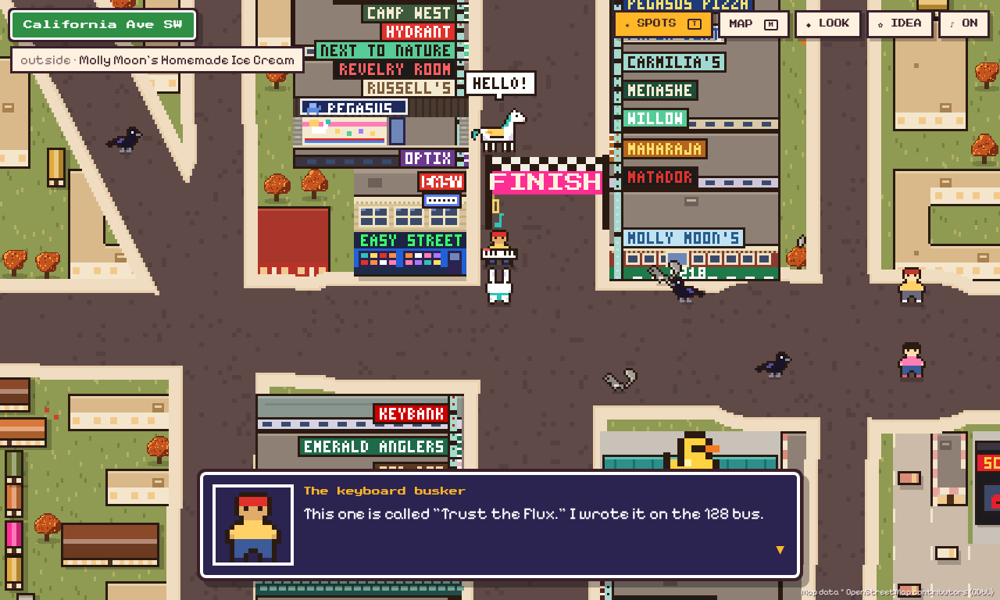 | 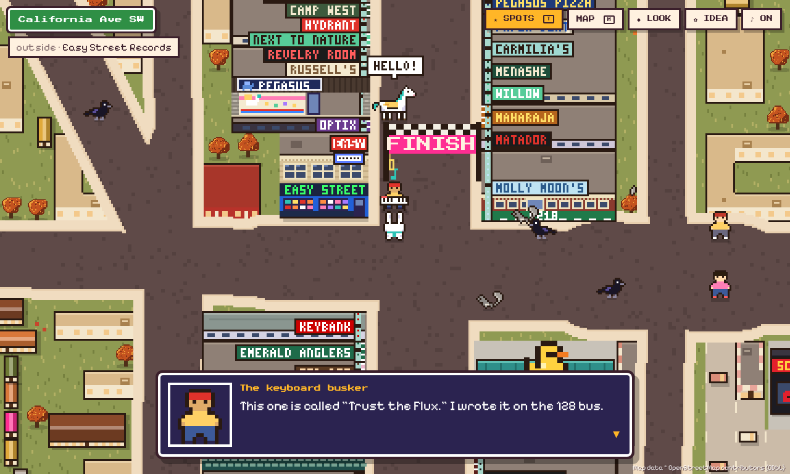 |

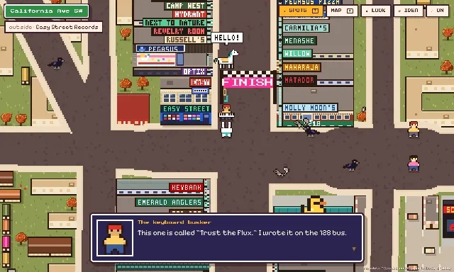

Jim · 1 files, +14 −0 · characters & map life · [record](changes/2026-11-15-pr076-busker-a-new-song-rainy-day-promenade/entry.json)

---

### Nov 15, 2026 · What {A} does is data, step 3: the plugin list by id, out of App.tsx ([#75](https://github.com/gardeninsound/map/pull/75))

**Asked vs made:** Asked for step 3 of the refactor. Made the plugin list by id, fixed `?open=crow`, and added a guard.

Nothing on the island looks different. The crow link now finds the snack crow.
🤖 Generated with [Claude Code](https://claude.com/claude-code)

| before · crow | after |
|---|---|
| 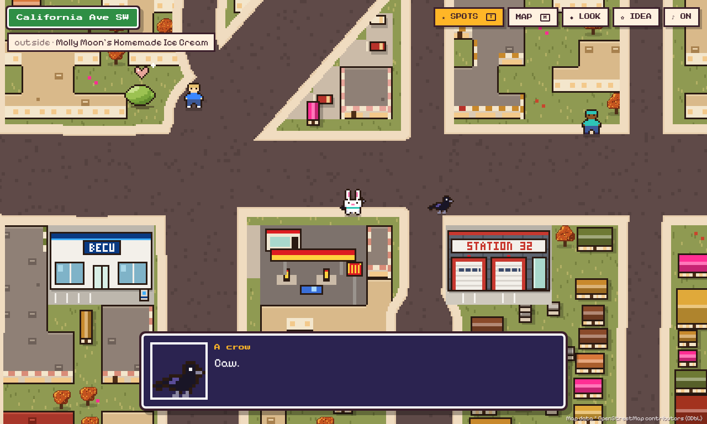 |  |

Jim · 9 files, +197 −58 · characters & map life, ui, docs, tools · [record](changes/2026-11-15-pr075-what-a-does-is-data-step-3-the-plugin-li/entry.json)

---

### Nov 15, 2026 · What {A} does is data, step 2: every plugin answers act() ([#74](https://github.com/gardeninsound/map/pull/74))

App.tsx's {A} handler, once 109 lines and touched by nearly every new character, is down to 11.
🤖 Generated with [Claude Code](https://claude.com/claude-code)

| before · the chicken, whose questions and mini game now live in her own plugin | after |
|---|---|
|  | 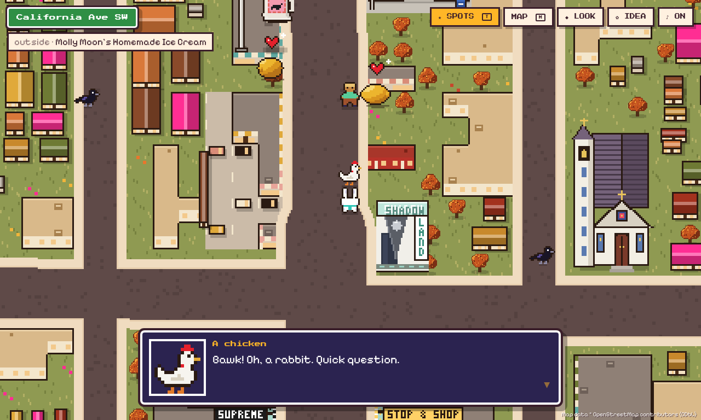 |

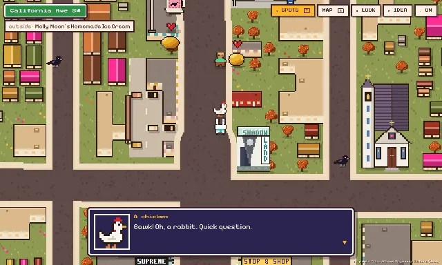

Jim · 15 files, +229 −115 · characters & map life, words & content, docs · [record](changes/2026-11-15-pr074-what-a-does-is-data-step-2-every-plugin/entry.json)

---

### Nov 15, 2026 · Make sure every Claude puts {A} in the plugin: a rule, a guard, a minigame action ([#73](https://github.com/gardeninsound/map/pull/73))

Two people each working with their own Claude: the instructions get them most of the way, the test catches the rest.
🤖 Generated with [Claude Code](https://claude.com/claude-code)

| before · the Junction, where everyone starts | after |
|---|---|
|  |  |

Jim · 6 files, +70 −8 · characters & map life, docs · [record](changes/2026-11-15-pr073-make-sure-every-claude-puts-a-in-the-plu/entry.json)

---

### Nov 15, 2026 · What {A} does is data: six plugins answer act(), App runs it ([#72](https://github.com/gardeninsound/map/pull/72))

The refactor the review settled on, instead of a kit of shared character behaviours: the duplication was in App's {A} handler, not in the characters.
🤖 Generated with [Claude Code](https://claude.com/claude-code)

| before · the Figure Eight's sign, now answered by its own plugin | after |
|---|---|
|  | 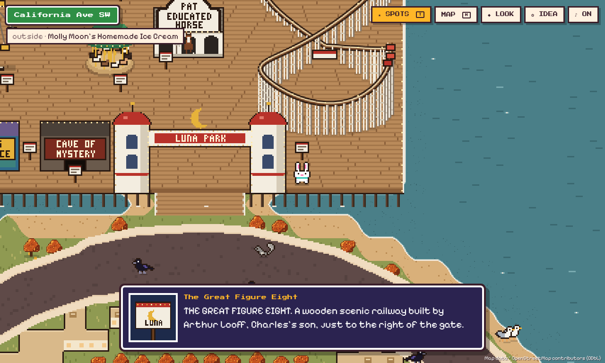 |

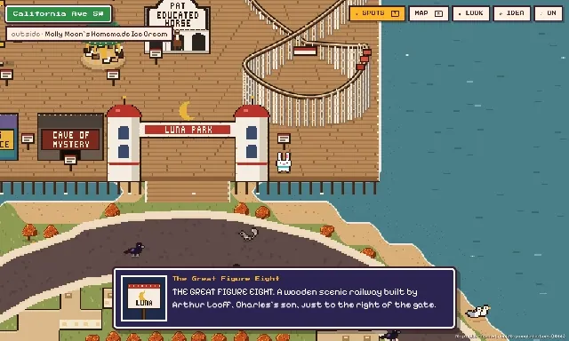

Jim · 11 files, +245 −67 · characters & map life, tools · [record](changes/2026-11-15-pr072-what-a-does-is-data-six-plugins-answer-a/entry.json)

---

### Nov 15, 2026 · One clock for the game (?time=, ?seed=) and ?open= links into anything ([#71](https://github.com/gardeninsound/map/pull/71))

Part of a review of how time, scenes, structures and characters work. The garden by month was the first thing it made possible to show.
🤖 Generated with [Claude Code](https://claude.com/claude-code)

| before · the garden sign in April | after |
|---|---|
| 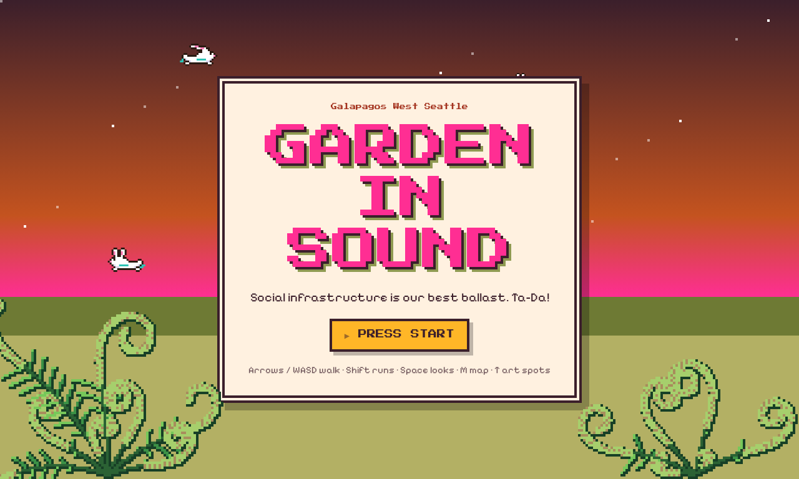 |  |

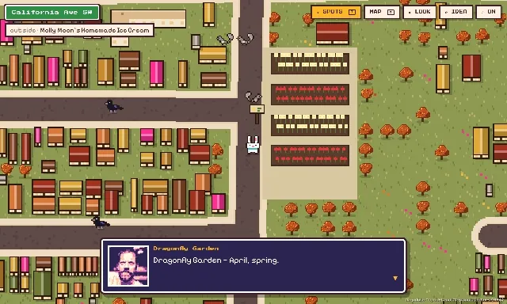

Jim · 25 files, +361 −67 · city, characters & map life, scenes & games, ui, ci, docs, tools · [record](changes/2026-11-15-pr071-one-clock-for-the-game-time-seed-and-ope/entry.json)

---

### Nov 15, 2026 · Map build: sites from data, so the stadium survives npm run map ([#70](https://github.com/gardeninsound/map/pull/70))

Found while reviewing how custom structures are built. The stadium would have vanished on the next map rebuild.
🤖 Generated with [Claude Code](https://claude.com/claude-code)

| before · the football field, West Seattle Stadium | after |
|---|---|
| 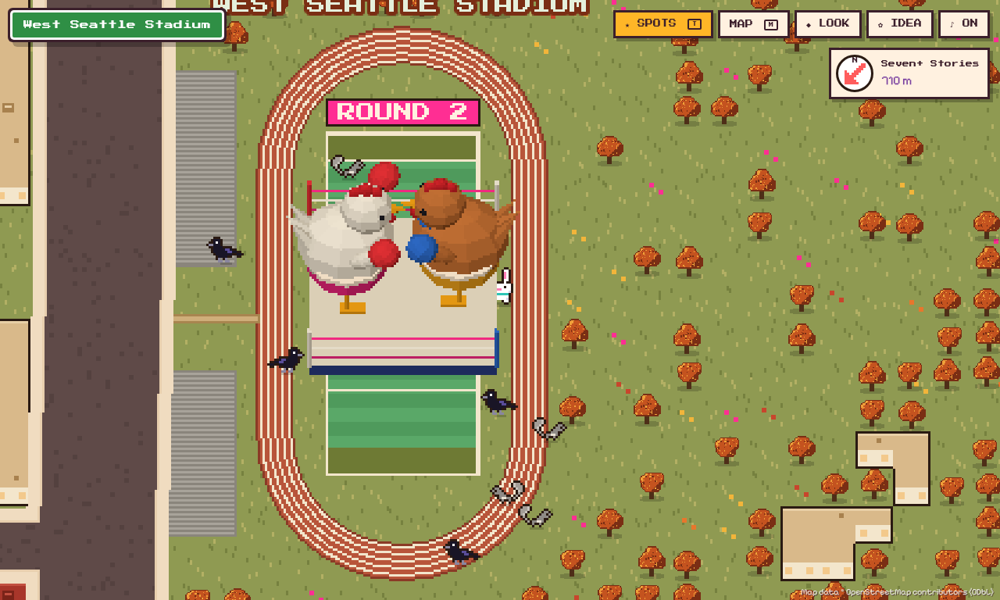 |  |

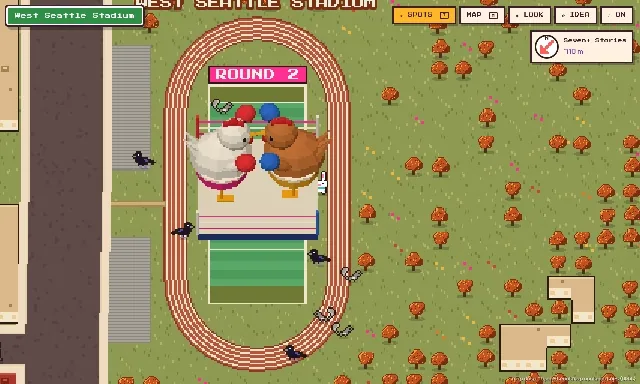

Jim · 6 files, +625 −8 · city, map pipeline, docs · [record](changes/2026-11-15-pr070-map-build-sites-from-data-so-the-stadium/entry.json)

---

### Nov 15, 2026 · Story log: early builds reach their places; retry failed shots ([#69](https://github.com/gardeninsound/map/pull/69))

Found when the first page of the log was nothing but intro screens. The site used to keep its "drop me here" link to developers only.
🤖 Generated with [Claude Code](https://claude.com/claude-code)

Jim · 5 files, +84 −10 · ci, docs, tools · [record](changes/2026-11-15-pr069-story-log-early-builds-reach-their-place/entry.json)

---

### Nov 15, 2026 · Story log: every change, wish and spot recorded, and a /story/ page to read it ([#68](https://github.com/gardeninsound/map/pull/68))

The log's first entry is the change that starts the log. The recorder was tried locally on 12 real changes; a regex that read the build's base path from a comment cost the recent ones their photos until fixed.
🤖 Generated with [Claude Code](https://claude.com/claude-code)

Jim · 18 files, +2122 −5 · ci, docs, tools · [record](changes/2026-11-15-pr068-story-log-every-change-wish-and-spot-rec/entry.json)

---

### Nov 14, 2026 · Pick your rabbit's look: fur, scarf and a hat (idea box #38, #34) ([#67](https://github.com/gardeninsound/map/pull/67))

> some little hats the rabits could wear and mini version of us and mst3k people walking around who we could talk to
>
> — **zia vallandingham jims kid** on California Ave SW, Nov 4, 2026 ([wish #34](https://github.com/gardeninsound/map/issues/34); live 10 days later)

> more character customization
>
> — a visitor on 47th Ave SW, Nov 4, 2026 ([wish #38](https://github.com/gardeninsound/map/issues/38); live 10 days later)

A LOOK button opens a panel: five furs, eight scarves and eight hats (beanie,
top hat, party hat, crown, flower crown, bucket hat, ball cap), each hat
previewed on your rabbit. Remembered in this browser and sent with your
rabbit as one number (a 7th field on the visitors wire; older clients ignore
it), so everyone online sees it, walking or on the bike. The engine gets
setPlayerSprites to swap yours in. Pure + tested.

| before · the Junction, where everyone starts | after |
|---|---|
|  | 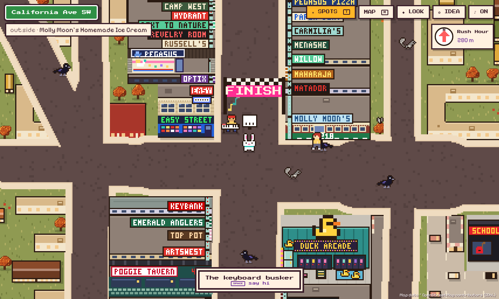 |

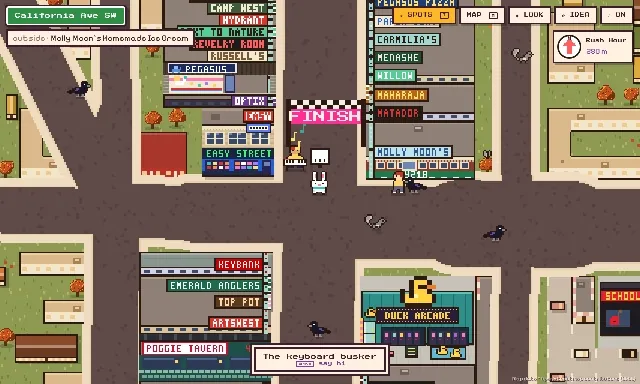

Mike · 11 files, +305 −13 · city, characters & map life, ui · [record](changes/2026-11-14-pr067-pick-your-rabbits-look-fur-scarf-and-a-h/entry.json)

---

### Nov 14, 2026 · A forest maze in Schmitz Preserve you can always hop out of (idea box #42) ([#66](https://github.com/gardeninsound/map/pull/66))

> forests could be like a maze, but you could always teleport out.
>
> — **YOUR SON!!!!!** on SW Hudson St, Nov 5, 2026 ([wish #42](https://github.com/gardeninsound/map/issues/42); live 9 days later)

A perfect maze (seeded, the same for everyone) carved through a 29x29 square
of the preserve's old-growth forest, entered off the street on the west side,
with dirt trails along its paths and a fairy ring in the clearing at the
middle. While you're in it, a hint at the top says {B} hops you out: back to
the street by the way in. Maze pure + tested.

| before | after |
|---|---|
| 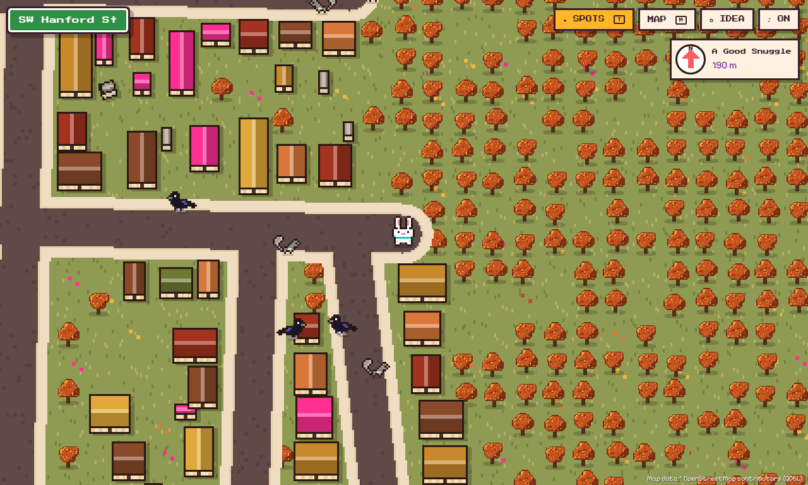 | 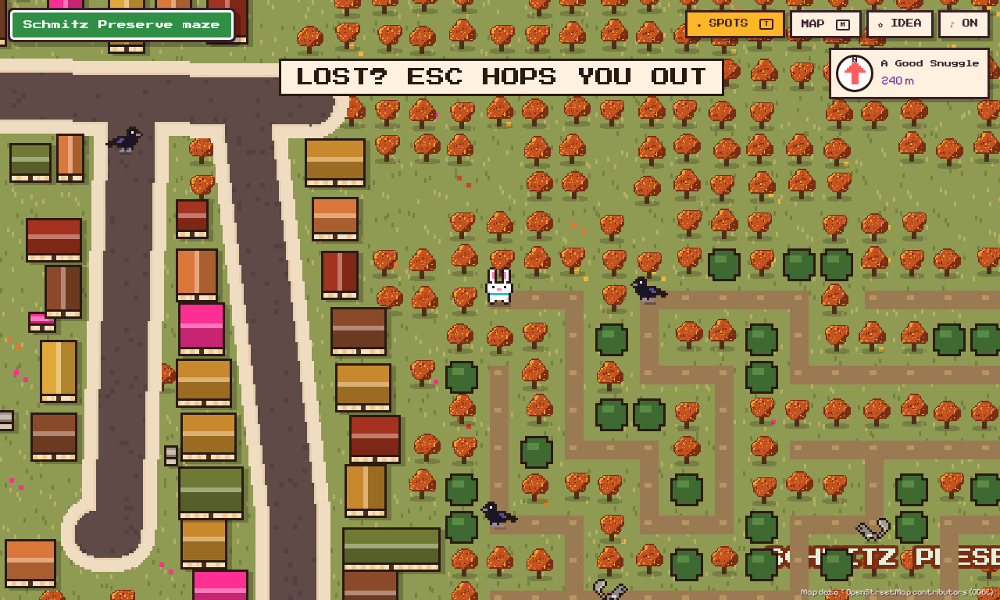 |

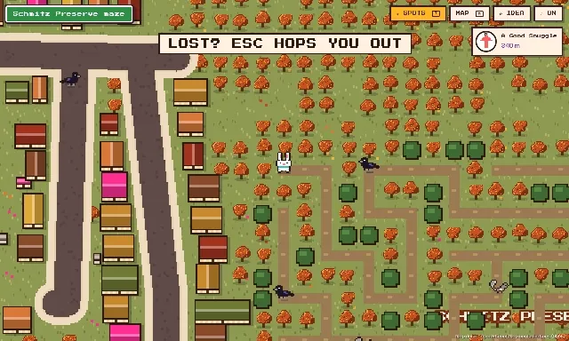

Mike · 6 files, +323 −2 · characters & map life, words & content · [record](changes/2026-11-14-pr066-a-forest-maze-in-schmitz-preserve-you-ca/entry.json)

---

### Nov 14, 2026 · A seasonal flower garden at Dragonfly Garden (idea box #12) ([#65](https://github.com/gardeninsound/map/pull/65))

> To see a garden with flowers growing - appropriate to the season
>
> — **Jimmy**, Nov 4, 2026 ([wish #12](https://github.com/gardeninsound/map/issues/12); live 10 days later)

Delridge's Dragonfly Garden is cleared of its drawn forest into soil beds and
gravel paths, planted by the real calendar: snowdrops and hellebores in late
winter, crocus, daffodils and tulips in spring, roses, lavender and sunflowers
in summer, dahlias, asters, mums and pumpkins in fall, kale in winter. Plants
come up, flower and fade across their months. A sign by the street says
what's out. Pure + tested.

| before · the garden in November, when it was planted | after |
|---|---|
|  |  |

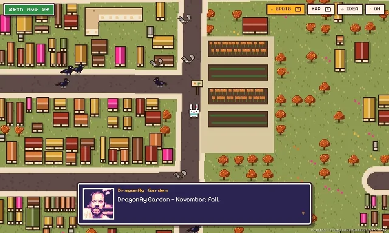

| before · the same garden in April | after |
|---|---|
| 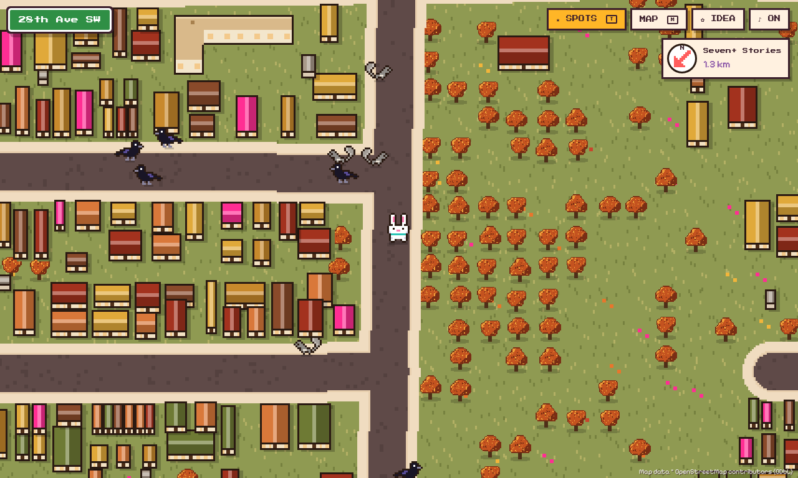 |  |

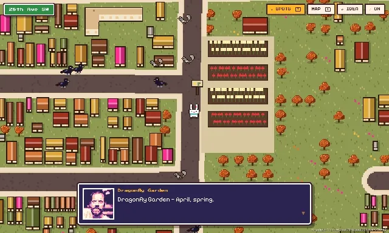

Mike · 6 files, +315 −2 · characters & map life, words & content · [record](changes/2026-11-14-pr065-a-seasonal-flower-garden-at-dragonfly-ga/entry.json)

---

### Nov 14, 2026 · Pastel ponies in Lincoln Park's meadow (idea box #36) ([#64](https://github.com/gardeninsound/map/pull/64))

> add my little ponys (g1)
>
> — a visitor on 47th Ave SW, Nov 4, 2026 ([wish #36](https://github.com/gardeninsound/map/issues/36); live 10 days later)

The idea asked for My Little Pony G1; those are someone else's characters, so
this is Bear Island's own herd: five pastel ponies with their own names graze
and trot about the meadow and its trails. Walk up and one stops to say hi.
Wandering pure + tested.

| before · Sundrop and the herd | after |
|---|---|
| 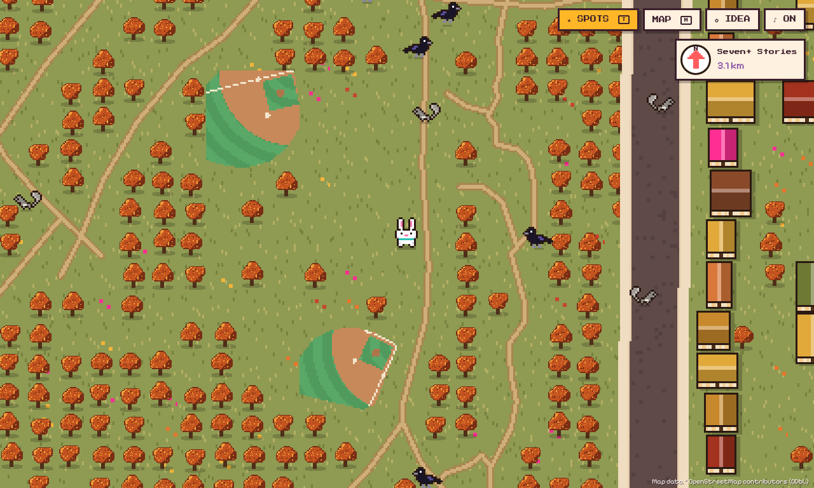 | 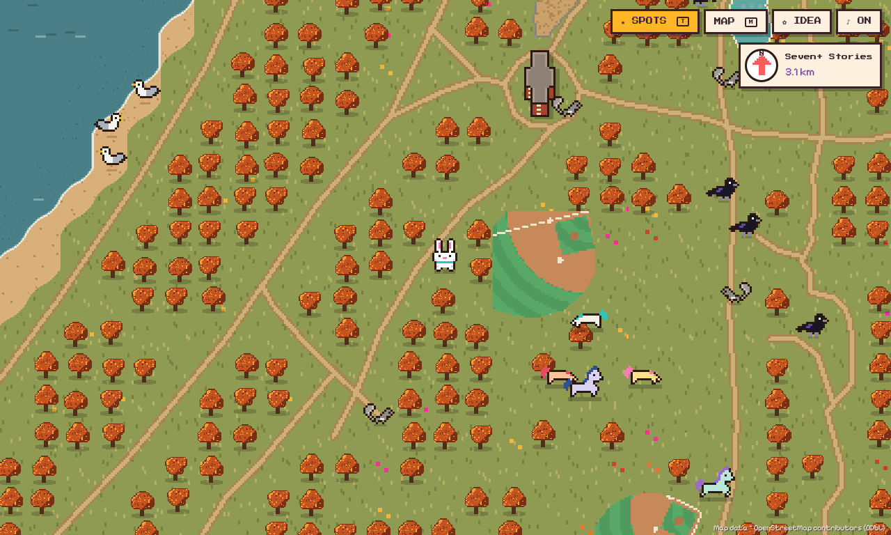 |

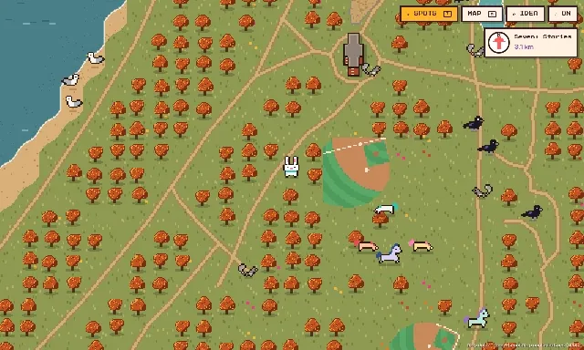

Mike · 7 files, +274 −2 · characters & map life, words & content · [record](changes/2026-11-14-pr064-pastel-ponies-in-lincoln-parks-meadow/entry.json)

---

### Nov 14, 2026 · Mermaids off Alki with catch phrases (idea box #37) ([#63](https://github.com/gardeninsound/map/pull/63))

> add mermaids saying catch phrases like "eyes closed sun so close"
>
> — **zia vallandingham** on 47th Ave SW, Nov 4, 2026 ([wish #37](https://github.com/gardeninsound/map/issues/37); live 10 days later)

Three mermaids on rocks just offshore: Marina by the 58th Ave rowboat dock
(walk up), Coral and Pearl along the beach (row up). Near the shore they call
out catch phrases in bubbles ("eyes closed sun so close"); up close, one
chats. Rocks and calls pure + tested.

| before | after |
|---|---|
|  | 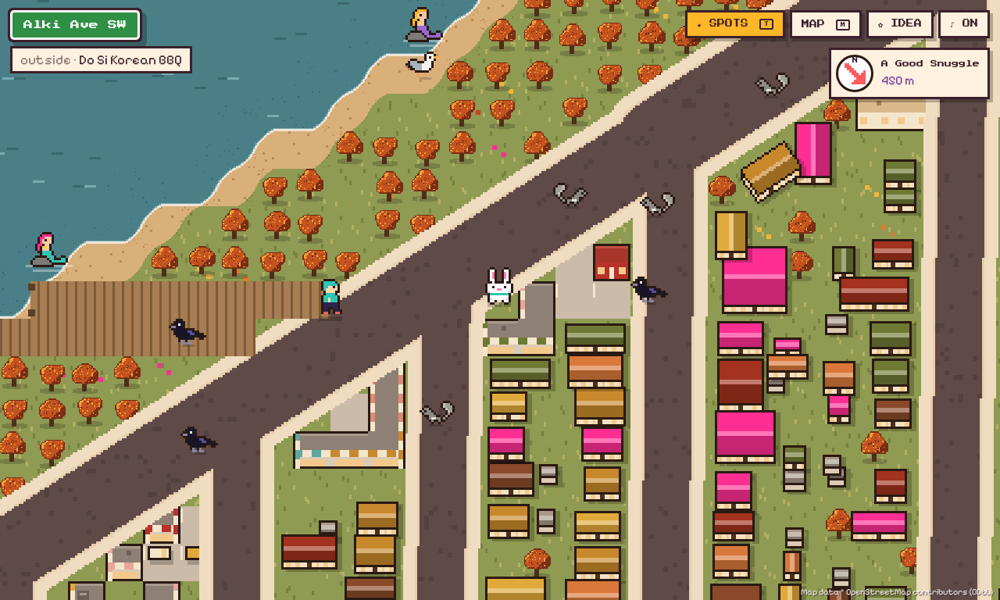 |

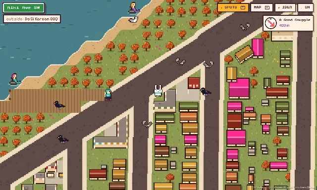

| before | after |
|---|---|
| 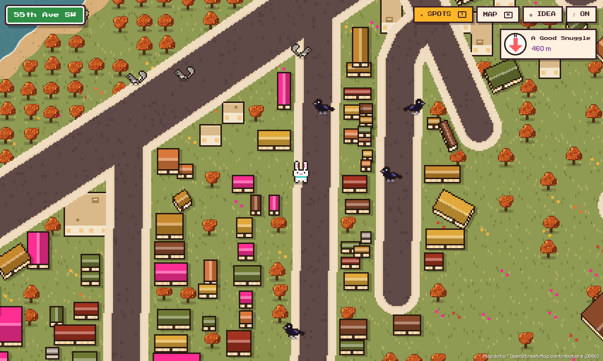 |  |

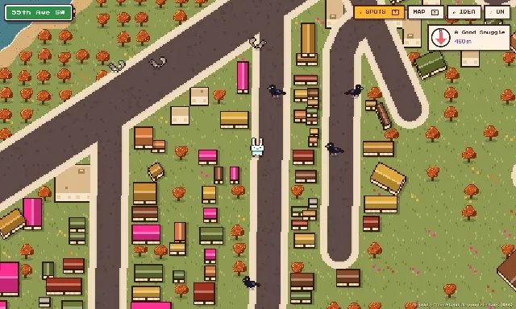

Mike · 7 files, +290 −2 · characters & map life, words & content · [record](changes/2026-11-14-pr063-mermaids-off-alki-with-catch-phrases/entry.json)

---

### Nov 14, 2026 · Squirrels that hide from people; Ham asks for pets (idea box #30) ([#62](https://github.com/gardeninsound/map/pull/62))

> Add some squirels that hide if humans draw neer, and ham the cat that asks for pets
>
> — **YOUR SON!!!!!** on 45th Ave SW, Nov 4, 2026 ([wish #30](https://github.com/gardeninsound/map/issues/30); live 10 days later)

Five squirrels scamper near park trees close to you; when a neighbor walks
by, one dashes up the nearest tree and hides, tail hanging out of the
leaves, till the coast is clear. Rabbits don't scare them. Ham now asks for
pets after the lines: pet, and Ham purrs with hearts floating up.

| before · Ham asks for pets | after |
|---|---|
|  |  |

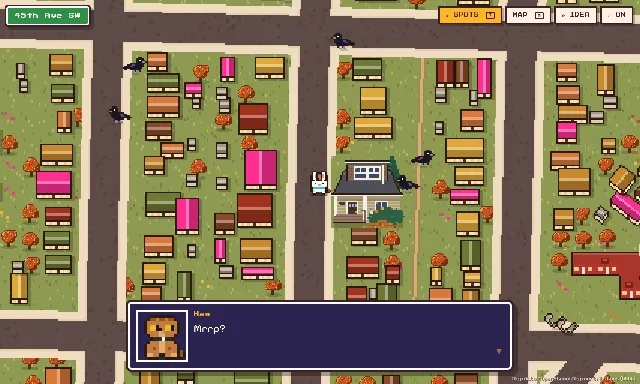

Mike · 9 files, +355 −3 · characters & map life, ui, words & content · [record](changes/2026-11-14-pr062-squirrels-that-hide-from-people-ham-asks/entry.json)

---

### Nov 14, 2026 · Hope Lutheran Church at 42nd & Oregon (idea box #44) ([#60](https://github.com/gardeninsound/map/pull/60))

> Can you add Hope Lutheran?
>
> — **Luca santo** on SW Dakota St, Nov 5, 2026 ([wish #44](https://github.com/gardeninsound/map/issues/44); live 9 days later)

A hand-drawn landmark on its OSM footprint, east side of 42nd Ave SW at SW
Oregon St, flush with 42nd: white walls, a steep roof running back north, the
bell tower with its cross on the street side, an arched door and a round
window in the south gable. No photo-quality description was found, so the
form is an interpretation (noted in the drawing's comment and the CSV).

Map data: only its footprint tiles (civic → landmark) and landmark entry.

| before | after |
|---|---|
| 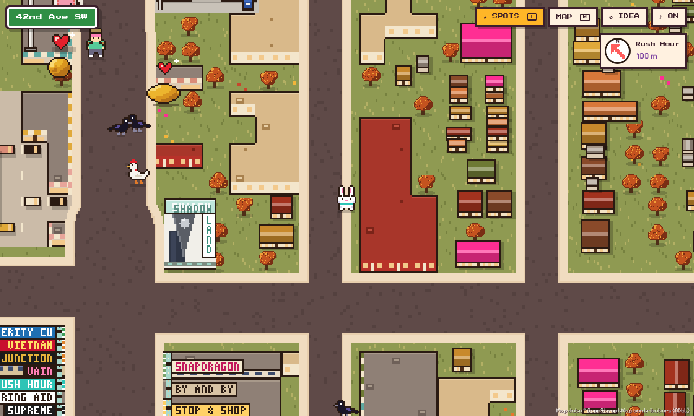 | 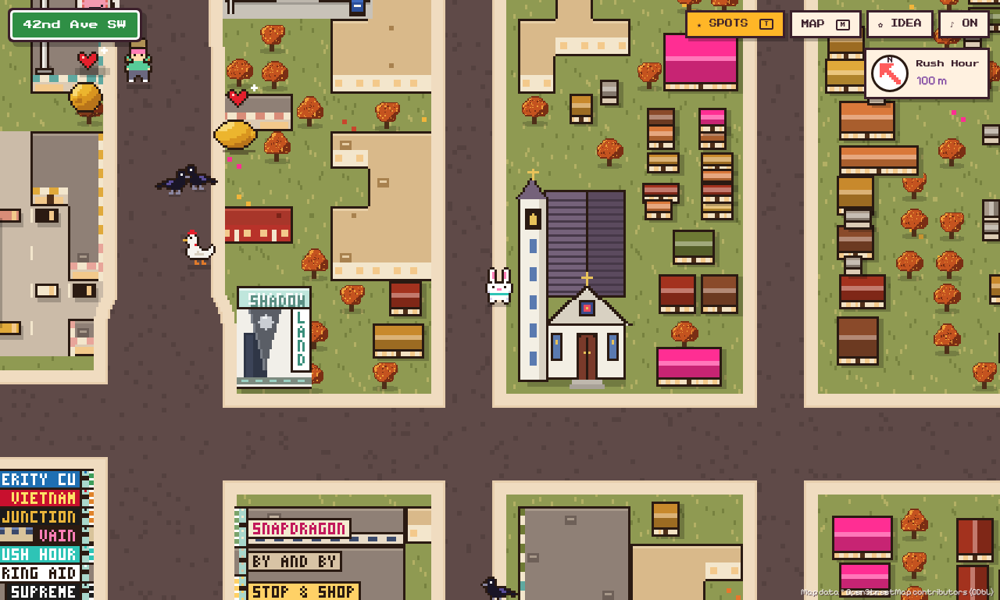 |

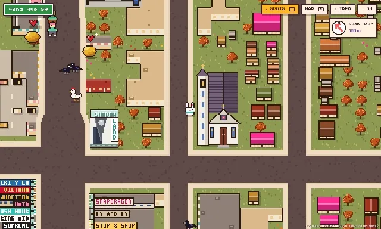

Mike · 5 files, +88 −2 · city, map pipeline · [record](changes/2026-11-14-pr060-hope-lutheran-church-at-42nd-oregon/entry.json)

---

### Nov 14, 2026 · Ride the Giant Whirl in Luna Park (idea box #41) ([#61](https://github.com/gardeninsound/map/pull/61))

> Make it so that you can ride the Giant Whirl in luna park.
>
> — **YOUR SON!!!!!** on Luna Park, Nov 5, 2026 ([wish #41](https://github.com/gardeninsound/map/issues/41); live 9 days later)

The Giant Whirl's sign now offers a ride: a first-person circle swing on the
pier at dusk. The striped tower spins up, your car swings out on its long arm
over the boardwalk and the bay, a long whirl at full speed, then it winds
down. Drag to look round; reduced motion watches from the boardwalk. Motion
pure + tested.

| before · riding the Giant Whirl | after |
|---|---|
|  | 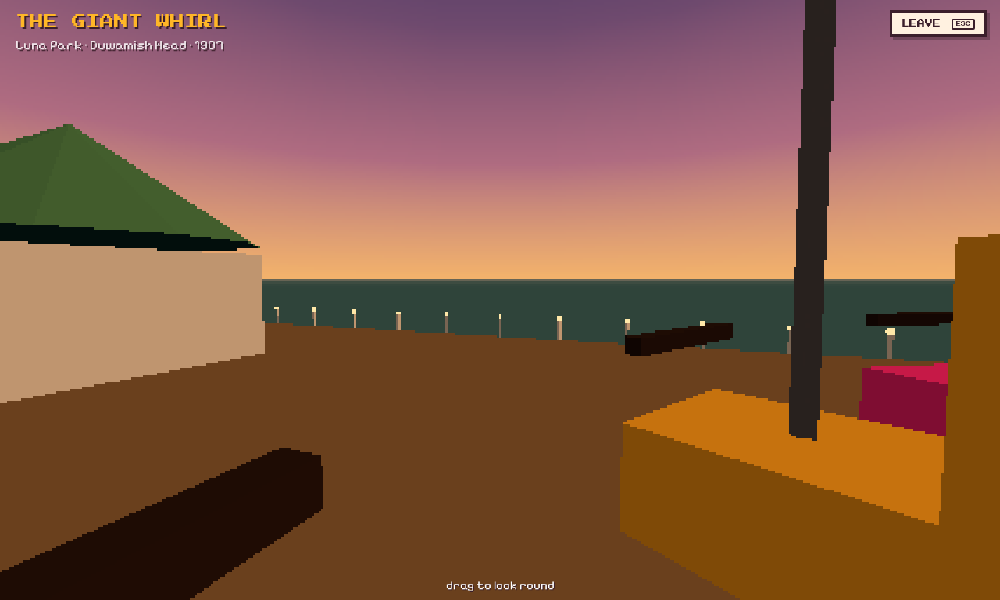 |

Mike · 7 files, +467 −4 · scenes & games, words & content · [record](changes/2026-11-14-pr061-ride-the-giant-whirl-in-luna-park/entry.json)

---

### Nov 14, 2026 · Crows on the streets, gulls on the beach (idea box #43, #40) ([#59](https://github.com/gardeninsound/map/pull/59))

> Add some sea gulls near the beach.
>
> — **YOUR SON!!!!!** on SW Hill St, Nov 5, 2026 ([wish #40](https://github.com/gardeninsound/map/issues/40); live 9 days later)

> MORE CROWS!!!
>
> — **YOUR SON!!!!!** on SW College St, Nov 5, 2026 ([wish #43](https://github.com/gardeninsound/map/issues/43); live 9 days later)

Seven crows always somewhere near you on the streets and six gulls on the
beach sand, pecking about; walk up and one flaps off away from you with a caw
or a gull's cry. Left far behind, a bird turns up again near you out of sight.
Rules pure + tested in game/flock.ts; new gull sprite.

| before · the Junction, where everyone starts | after |
|---|---|
| 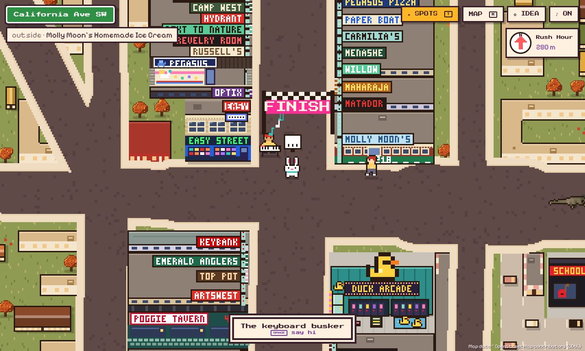 |  |

Mike · 7 files, +281 −2 · characters & map life, ui · [record](changes/2026-11-14-pr059-crows-on-the-streets-gulls-on-the-beach/entry.json)

---

### Nov 14, 2026 · Finer trees and shoreline (half-size pixels); thin trails in Lincoln Park ([#55](https://github.com/gardeninsound/map/pull/55))

Chunks and the map canvas now hold 2× the map's pixels. Everything is drawn at
map size and looks as before, but:
- trees are drawn at the fine pixels: a lumpy canopy lit from the top left,
  outline, leaf flecks, trunk, soft shadow, in three shapes
- the shoreline is worked out per fine pixel (each blends the four nearest
  tiles), so the waterline and the beach's inland edge run in curves, with a
  fine foam line and wash
- both only over bare ground: a 1× chunk is built first (trees left out), and
  anything painted over the ground (roads, houses, fields, docks) stays on top
- park trails are thin dirt paths down the middle of their walkable corridor
The newest 40 fine chunks are kept; the road audit reads the 1× chunk.

| before · the Junction, where everyone starts | after |
|---|---|
|  |  |

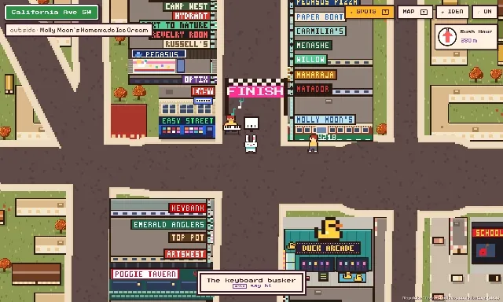

Mike · 6 files, +318 −23 · city · [record](changes/2026-11-14-pr055-finer-trees-and-shoreline-half-size-pixe/entry.json)

---

### Nov 14, 2026 · The Admiral-to-Alaska bike race: animals on bikes down California ([#56](https://github.com/gardeninsound/map/pull/56))

Seven animals on bicycles (a fox, bear, cat, raccoon, frog, duck and dog in
numbered jerseys) wait under a START banner on California Ave at SW Admiral
Way. {A} there puts your rabbit on the grid on its bike; 3-2-1-GO, and everyone
races south down California to the FINISH banner at SW Alaska St (~2.2 km).
Your place and time show at the top; at the line the winner says how you did.
Ride off the course and you've left the race; once you're well away, the
animals are back on the line for the next one.

Course (California's own run of road, row by row), riders and standings pure +
tested (game/bikeRace.ts). City: BIKE_GRIDS exported; a Vehicle can count as
riding, so other rabbits see your bike in the race.

| before | after |
|---|---|
| 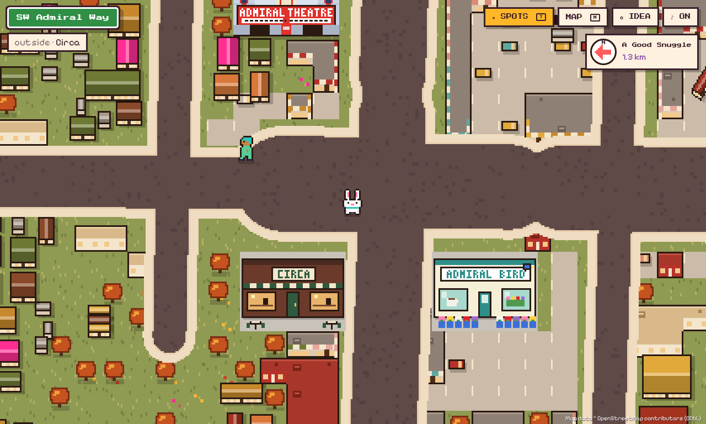 | 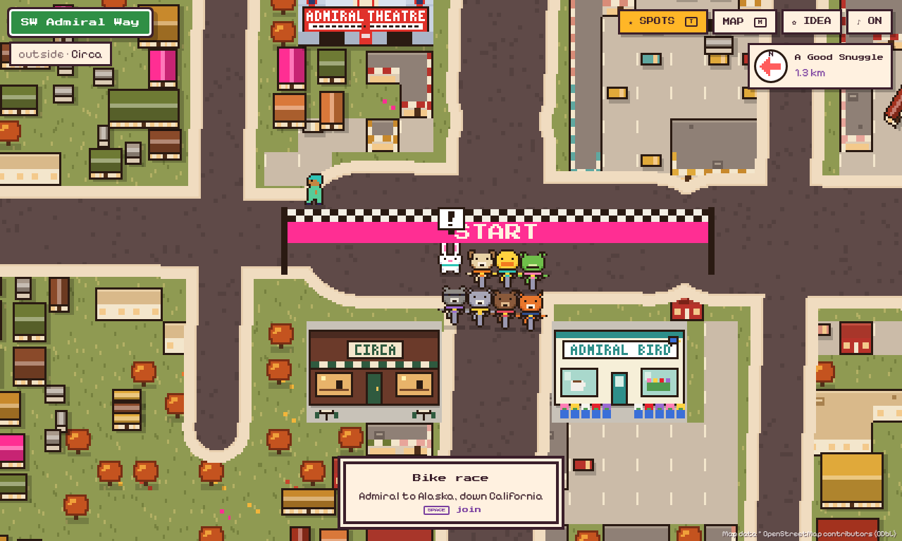 |

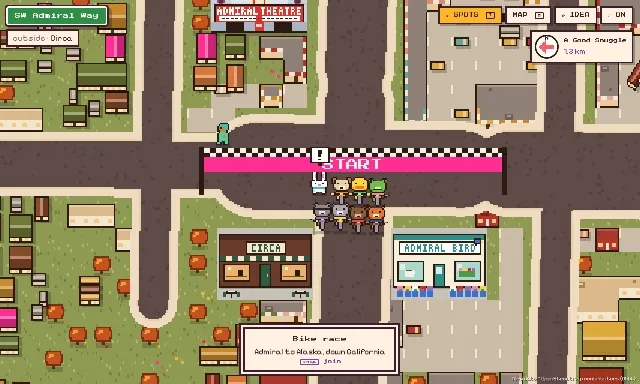

| before | after |
|---|---|
| 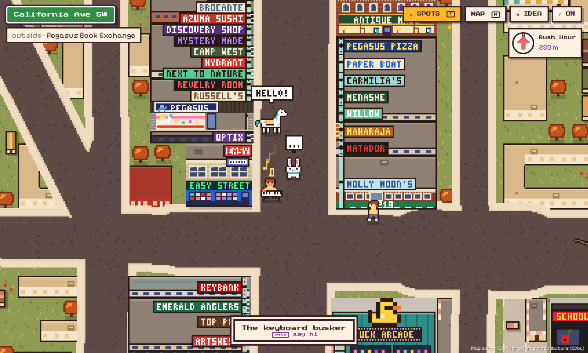 | 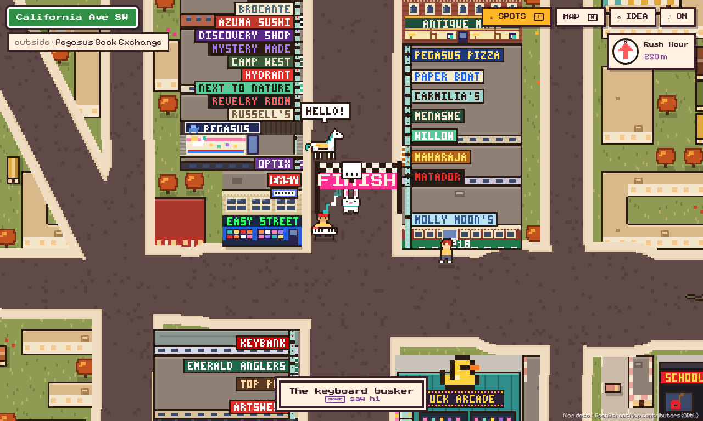 |

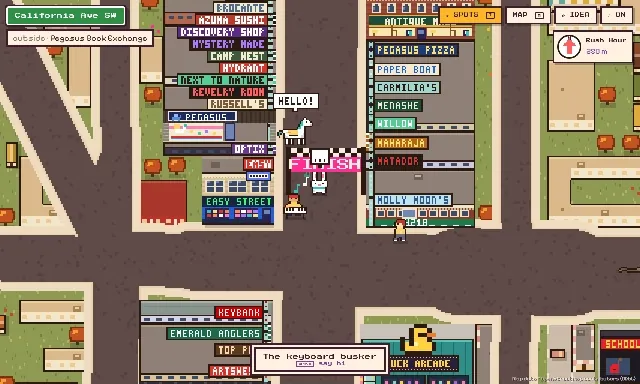

Mike · 10 files, +618 −5 · city, characters & map life, ui, words & content · [record](changes/2026-11-14-pr056-the-admiral-to-alaska-bike-race-animals/entry.json)

---

### Nov 14, 2026 · Dinosaurs: no more sound (the stray "thanks") ([#53](https://github.com/gardeninsound/map/pull/53))

The recording they played going by (public/sounds/dinosaur.mp3) was a "thanks",
heard at random whenever a dinosaur passed. Removed the file, the code that
played it (HEAR, HEAR_GAP, hearDino, DINO_SOUND) and its tests. The dinosaurs
still walk west; they're silent now.

| before · the Junction, where everyone starts | after |
|---|---|
|  |  |

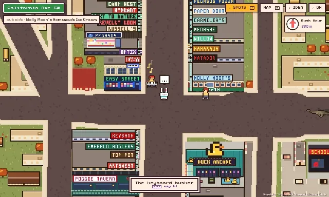

Mike · 6 files, +4 −66 · characters & map life, words & content, art & sound · [record](changes/2026-11-14-pr053-dinosaurs-no-more-sound-the-stray-thanks/entry.json)

---

### Nov 14, 2026 · Giant chickens boxing in West Seattle Stadium ([#58](https://github.com/gardeninsound/map/pull/58))

A ring on the football field; two ~5-tile-tall low-poly chickens (three.js,
lazy-loaded near the stadium, rendered at map-pixel size) slug it out on the
wall clock: rounds, knockdowns with a count, rests in the corners, feathers
and a thud on every landed punch, the bell each round. Ringside, the ring
announcer sums up the bout. Fight rules pure + tested.

OSM has only an unnamed wooded park there. Hand-patched into worldData: lawn
grounds, walkable track and football field, grandstands along 35th with a gate
path between them from the sidewalk, and the name in the HUD.
Stacked on #57 (West Seattle Stadium access) — merge that first; this PR's diff includes it until then.

| before · the announcer at chicken boxing | after |
|---|---|
| 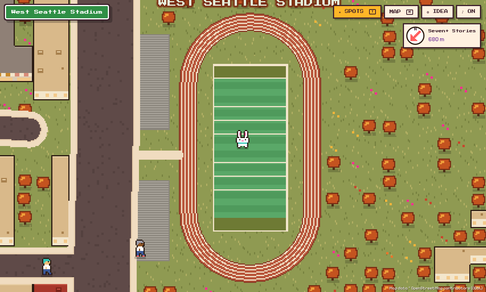 |  |

Mike · 8 files, +629 −2 · characters & map life, ui, words & content · [record](changes/2026-11-14-pr058-giant-chickens-boxing-in-west-seattle-st/entry.json)

---

### Nov 14, 2026 · West Seattle Stadium: a way in off 35th Ave SW ([#57](https://github.com/gardeninsound/map/pull/57))

OSM has only an unnamed wooded park there. Hand-patched into worldData: lawn
grounds, walkable track and football field, grandstands along 35th with a gate
path between them from the sidewalk, and the name in the HUD.

| before · the Junction, where everyone starts | after |
|---|---|
|  |  |

Mike · 2 files, +4 −1 · city · [record](changes/2026-11-14-pr057-west-seattle-stadium-a-way-in-off-35th-a/entry.json)

---

### Nov 14, 2026 · Fall colours, with some hot pink ([#54](https://github.com/gardeninsound/map/pull/54))

The map palette goes autumn: olive-gold lawns, trees burnt orange, rust and
gold, fallen leaves in the grass (some hot pink), a cooler grey-teal sea, warm
sand, rust/pumpkin/mustard roofs with the odd hot-pink one, amber windows. The
same swap where landmark, park and Cone Catch drawings copied the old greens.
UI: a louder hot pink, marigold for yellow, olive for teal, aubergine outlines,
warmer paper; the title screen gets an autumn dusk. The 3D rooms are unchanged.

| before · the Junction, where everyone starts | after |
|---|---|
|  |  |

Mike · 9 files, +66 −61 · city, characters & map life, scenes & games · [record](changes/2026-11-14-pr054-fall-colours-with-some-hot-pink/entry.json)

---

### Nov 14, 2026 · Pelican: comes after 5 minutes; tap Space and it flies to IDEA right away ([#52](https://github.com/gardeninsound/map/pull/52))

PELICAN_AFTER 120 → 300 s. While it's flying in or asking beside you, {A}
(Space) sends it straight up to the IDEA button (skipAhead, pure + tested);
that press is the pelican's alone, so it doesn't also talk to anyone nearby.

| before · the Junction, where everyone starts | after |
|---|---|
|  |  |

Mike · 5 files, +49 −8 · characters & map life, ui, words & content · [record](changes/2026-11-14-pr052-pelican-comes-after-5-minutes-tap-space/entry.json)

---

### Nov 14, 2026 · Duck Arcade: "Paddles at Dawn" loops quietly while you're on the floor ([#50](https://github.com/gardeninsound/map/pull/50))

Mike's track (public/arcade/Paddles_at_Dawn.mp3, 1:07, 1.6 MB) plays at 20%
volume, looping, from the moment you walk in; it pauses while a cabinet's game
plays (each has its own sound) and picks up again after; silent when the map is
muted. File and volume: ARCADE_MUSIC in content/duckArcade.ts; in the
published-files test.

| before · the arcade floor, Paddles at Dawn playing | after |
|---|---|
|  |  |

Mike · 5 files, +27 −2 · scenes & games, words & content, art & sound · [record](changes/2026-11-14-pr050-duck-arcade-paddles-at-dawn-loops-quietl/entry.json)

---

### Nov 14, 2026 · Duck Arcade: a deer plays Quack Hero, bobbing to the beat ([#51](https://github.com/gardeninsound/map/pull/51))

A low-poly cartoon buck (antlers, white tail) stands at the Quack Hero cabinet
from the moment you walk in: front hooves tapping the buttons on the beat, head
bobbing, ears twitching, tail flicking, a little hop now and then. Its screen
shows the rhythm game going (rubber-duck notes down three lanes, a DEER score).
You and the bear walk round it; the bear coming over no longer stops other
cabinets' screens. DEER_GAME in content/duckArcade.ts; a test checks its
cabinet and the bear's both stand in the room.

| before · the deer at Quack Hero | after |
|---|---|
|  |  |

Mike · 5 files, +206 −10 · scenes & games, words & content · [record](changes/2026-11-14-pr051-duck-arcade-a-deer-plays-quack-hero-bobb/entry.json)

---

### Nov 8, 2026 · The original Alki bathhouse: the 1911 Bathing Pavilion, in 8-bit on its site ([#48](https://github.com/gardeninsound/map/pull/48))

The original Alki bathhouse, the 1911 Bathing Pavilion (gone since 1955), in 8-bit on its own site, where today's bathhouse stands (2701 Alki Ave SW). A 5×3 hand-drawn landmark.

- **From the written record:** a large white wood-frame Recreation Pavilion, dedicated July 4, 1911, with a spectators' viewing balcony, a café, a gym, club rooms and dressing rooms, behind a wide planked promenade.
- **An interpretation:** its roof and number of storeys aren't described in any source found, so the hipped roof and full-width balcony are a period reading. Sources are in the drawing's comment and below.
- **Extras:** spectators at the rail, bathers in striped wool suits on the boards.

Sources: [Paul Dorpat, Now & Then](https://pauldorpat.com/2011/07/16/seattle-now-then-antique-alki-swimwear/) · [Seattle DON historic sites](https://web.seattle.gov/DPD/HistoricalSite/QueryResult.aspx?ID=191867477) · [Olmsted Online #02716](https://olmstedonline.org/Job/Details/02716)

**Jim, heads-up (map data):** as with Dakota Place (#46), only its footprint and landmark entry are patched into `worldData.json`, not a full rebuild from my local OSM copy. Merged with `main`: both landmarks kept everywhere.

| before | after |
|---|---|
|  |  |

Mike · 5 files, +97 −2 · city, map pipeline · [record](changes/2026-11-08-pr048-the-original-alki-bathhouse-the-1911-bat/entry.json)

---

### Nov 8, 2026 · Dinosaurs: two near you instead of six ([#49](https://github.com/gardeninsound/map/pull/49))

Dinosaurs are a rarer sight: two near you instead of six (`DINO_COUNT` 6 → 2). Their sound plays less often too, since fewer pass by.

| before · the Junction, where everyone starts | after |
|---|---|
|  |  |

Mike · 2 files, +2 −2 · characters & map life · [record](changes/2026-11-08-pr049-dinosaurs-two-near-you-instead-of-six/entry.json)

---

### Nov 8, 2026 · A rowboat at the end of 58th on Alki: climb in and paddle around ([#47](https://github.com/gardeninsound/map/pull/47))

A rowboat at the end of 58th Ave SW on Alki: climb in and paddle around Puget Sound.

- **Dock and boat:** a 2-wide wooden dock ("58th Ave Dock") runs from where 58th meets Alki Ave, across the park and sand to the water, with the rowboat tied up at its end. It's painted as planks, and its tiles are made walkable at attach, like Luna Park's pier.
- **Rowing:** {A} climbs in. You row on water only, with oar strokes, a splash, a soft paddle sound and a wake. {A} climbs out wherever walkable ground is within reach: the dock, a pier, not the sand.
- **Left behind**, far away, the boat drifts home to the dock.
- Rules pure + tested in `src/game/rowboat.ts` (incl. React's dev double start, which used to lay no dock the second time). Sprites drawn round the rabbit's own frames.

**Jim, heads-up (`src/city/`):** a small general `Vehicle` hook on `CityGame`: `game.vehicle = { canGo, speed, sprite, fps? }` takes over where the player can go, how fast and how it's drawn; Shift does nothing in one. Plus the plugin line and a dev hook in `App.tsx`. Other players still see a rabbit on the water: nothing on the wire says "in a boat" yet.

| before · the Junction, where everyone starts | after |
|---|---|
|  |  |

Mike · 11 files, +461 −11 · city, characters & map life, ui, words & content · [record](changes/2026-11-08-pr047-a-rowboat-at-the-end-of-58th-on-alki-cli/entry.json)

---

### Nov 8, 2026 · Dakota Place Park in 8-bit: the old brick substation and its plaza ([#46](https://github.com/gardeninsound/map/pull/46))

Dakota Place Park in 8-bit: a hand-drawn landmark (4×3 tiles) on the NW corner of California Ave SW & SW Dakota St.

- **The building:** the 1920s California Avenue Substation (Seattle City Light): one-story brick, tall many-paned windows, a flat roof behind a concrete parapet. Its front door is up a few steps facing Dakota.
- **Around it:** a paved plaza on its west side with a tree, a bench and a planter; lawn, shrubs and the brown Seattle Parks sign.

Sources: [Seattle Parks](https://seattle.gov/parks/parks/dakota-place-park), [the city's landmark report](https://www.seattle.gov/documents/departments/neighborhoods/historicpreservation/landmarks/relateddocuments/cal-ave-substation-designation.pdf).

**Jim, heads-up (map data):** my local OSM copy differs a little from your last build, so instead of a full `npm run map` I patched only the park into `worldData.json`: its 12 footprint tiles, its landmark entry, and the 2 houses it replaces. The next real rebuild reproduces it from `content/landmarks.csv`.

| before | after |
|---|---|
|  |  |

Mike · 5 files, +110 −2 · city, map pipeline · [record](changes/2026-11-08-pr046-dakota-place-park-in-8-bit-the-old-brick/entry.json)

---

### Nov 8, 2026 · Pelican: comes 2 minutes after you join, not 10 seconds ([#45](https://github.com/gardeninsound/map/pull/45))

The pelican now comes 2 minutes after you join (it was 10 seconds), still waiting if a dialog or scene is open. `PELICAN_AFTER` 10 → 120, plus its notes.

| before · the Junction, where everyone starts | after |
|---|---|
|  |  |

Mike · 3 files, +3 −3 · characters & map life, ui, words & content · [record](changes/2026-11-08-pr045-pelican-comes-2-minutes-after-you-join-n/entry.json)

---

### Nov 4, 2026 · CLAUDE.md becomes an index; each area's notes move to its own folder's CLAUDE.md ([#39](https://github.com/gardeninsound/map/pull/39))

The root CLAUDE.md was turning into a changelog: almost every PR edited its "Where things live" section, all of it loaded every session, and parallel PRs conflicted on it.

- **Root CLAUDE.md** (276 → 150 lines): commands, git workflow, Check, conventions and verifying unchanged; "Where things live" is now a one-line-per-area index, plus the rule that a new feature adds its line to its area's file, not the root.
- **Per-folder notes**, loaded only when Claude works there: `src/game/`, `src/experiences/`, `src/ui/`, `src/city/`, `wish/`. Text moved word for word, apart from short headers and a few cross-pointers.
- **AI helper**: `forbidden()` now refuses every `CLAUDE.md`, not just the root one (tested).

| before · the Junction, where everyone starts | after |
|---|---|
|  |  |

Jim · 8 files, +204 −148 · city, characters & map life, scenes & games, ui, idea box, docs, tools · [record](changes/2026-11-04-pr039-claudemd-becomes-an-index-each-areas-not/entry.json)

---

### Nov 4, 2026 · Toy dinosaurs plod west along the east–west streets ([#35](https://github.com/gardeninsound/map/pull/35))

Mike's walking toy dinosaur GIF, plodding west along the east–west streets, with his recording playing as one goes by.

- **Sprite:** `node scripts/make-dino.mjs &lt;dino.gif&gt;` keys out the green backdrop, keeps the shadow (see-through) and inks an outline. Output: a 42-frame, 52×19 sheet, `public/sprites/dino-walk.png` (9 KB), plus `src/game/dinoSheet.ts`. The 5.8 MB GIF isn't kept.
- **Walking:** six are always near you, each walking west down the middle of a "SW … St". At the end of the street, or once far behind you, it turns up on another east–west street nearby, out of sight. Pure + tested: `src/game/dinos.ts`.
- **Sound:** Mike's recording, as `public/sounds/dinosaur.mp3` (55 KB). It plays once a pass when a dinosaur comes within 6 tiles; never two at once; quiet in scenes and when muted.
- Both files are in the published-files test.
- **Jim, heads-up:** a plugin line + dev hook in `App.tsx`, and a CLAUDE.md note. Merged with `main` (Ham and the pelican kept).

| before | after |
|---|---|
|  |  |

| before | after |
|---|---|
|  |  |

Mike · 10 files, +393 −2 · characters & map life, words & content, art & sound, docs, tools · [record](changes/2026-11-04-pr035-toy-dinosaurs-plod-west-along-the-eastwe/entry.json)

---

### Nov 4, 2026 · AI helper: free models turn idea-box suggestions into small, checked changes (run by hand) ([#20](https://github.com/gardeninsound/map/pull/20))

An experiment: can a **free** AI model turn a visitor's idea (an issue labelled `suggestion`) into a small, correct change? Run by hand on a laptop; nothing is automated, and nothing changes on the live site.

| before · the Junction, where everyone starts | after |
|---|---|
|  |  |

Jim · 13 files, +932 −2 · characters & map life, words & content, docs, tools · [record](changes/2026-11-04-pr020-ai-helper-free-models-turn-idea-box-sugg/entry.json)

---

### Nov 4, 2026 · Take the RECENT button off the HUD ([#33](https://github.com/gardeninsound/map/pull/33))

Takes the RECENT button off the HUD (Mike's call). Also removes what only it used: the jump to each recent change, its caption, and its list (`src/content/recent.ts`).

**Jim, heads-up:**
- The smoke test used RECENT to reach the Duck Arcade. It now goes straight there with the new `?at=arcade`.
- `?at=lat,lon` / `?atTile=x,y` now work on the live site too, not only in dev: a link that starts you somewhere, no title screen. `__` dev hooks and `?audit` stay dev-only.
- Touches `App.tsx`, `scripts/smoke.mjs` and CLAUDE.md. Merged with `main` (Ham's dev hook kept).

| before · the Junction, where everyone starts | after |
|---|---|
|  |  |

Mike · 5 files, +19 −101 · words & content, docs, tools · [record](changes/2026-11-04-pr033-take-the-recent-button-off-the-hud/entry.json)

---

### Nov 4, 2026 · A pelican points out the idea box, 10 s after you join ([#32](https://github.com/gardeninsound/map/pull/32))

Once a session, 10 seconds after you're on the map (waiting if a dialog or scene is open), a pelican flies in and lands beside your rabbit: "Anything you want to add, pumpkin?" Then it flies up onto the ✿ IDEA button, which lights yellow and bobs, says "Dream it out!", and flies off the screen.

- HTML laid over the map and the HUD; it never takes a click. Opening anything (the idea box included) ends its visit.
- Flight and timing are pure + tested: `src/game/pelican.ts`. Words: `src/content/pelican.ts` (drafts for Mike). 24-wide sprite in `sprites.ts`.
- Reduced motion: no flying across the screen, but still time to read each line.
- **Jim, heads-up:** `CityGame` gets `scale` and `screenPoint(tile)`, so HTML can be placed over a map point. `App.tsx` gets the 10 s timer and the overlay, and CLAUDE.md a note. Merged with `main`; the Ham sprite and the pelican sit side by side in `sprites.ts`.

| before · the Junction, where everyone starts | after |
|---|---|
|  |  |

Mike · 10 files, +400 −0 · city, characters & map life, ui, words & content, docs · [record](changes/2026-11-04-pr032-a-pelican-points-out-the-idea-box-10-s-a/entry.json)

---

### Nov 4, 2026 · A hidden house on 45th, a walkable alley, and Ham the cat ([#31](https://github.com/gardeninsound/map/pull/31))

- **Hidden house** at 1918 45th Ave SW: a hand-drawn 1½-storey Craftsman (shed dormer, porch, steps, rhododendron with pumpkins, leaf pile) as a nameless landmark, so it never shows on the map's place list; you find it by walking past.
- **Walkable alley** behind it (Hill → Holgate): `ALLEYS` in `scripts/city/map-config.mjs` turns listed alleys into concrete lanes, named "Alley" in the HUD.
- **Ham the cat** (Scottish Fold): wanders the street and alley within 8 tiles of home, sits to look at a rabbit that comes close, mews and says one set of lines per visit. Movement pure + tested (`src/game/ham.ts`), lines in `src/content/ham.ts`.
- Map rebuilt from fresh OSM (~28 unrelated tiles changed).

Not set to auto-merge: holding for a look at the preview first.

| before · Ham the cat | after |
|---|---|
|  |  |

| before · the hidden house on 45th | after |
|---|---|
|  |  |

Jim · 15 files, +472 −6 · city, map pipeline, characters & map life, ui, words & content, docs · [record](changes/2026-11-04-pr031-a-hidden-house-on-45th-a-walkable-alley/entry.json)

---

### Nov 4, 2026 · Previews: when a PR closes, its preview becomes a "this preview has closed" page ([#29](https://github.com/gardeninsound/map/pull/29))

When a PR closes (merged or not), its preview stops being a live copy of the site.

- **`.github/workflows/preview-cleanup.yml`**, on `pull_request: closed`:
  - re-uploads `pr-&lt;N&gt;` with `preview/closed/index.html`, a short "This preview has closed" page linking to the live site, with no game, relay or idea box;
  - marks the PR's `preview` deployments inactive, so GitHub stops showing an active deployment.
- **Why:** old previews stayed online forever, joining the real relay with old code and able to file real ideas. Cloudflare has no command to delete a preview alias; uploading over one replaces it. It also keeps at most 1,000 aliases per Worker.
- It shares the `preview-&lt;N&gt;` concurrency group with the Preview workflow without cancelling it, so a last upload finishes before the preview is closed.

Jim · 5 files, +92 −1 · ci, docs · [record](changes/2026-11-04-pr029-previews-when-a-pr-closes-its-preview-be/entry.json)

---

### Nov 4, 2026 · Duck Arcade: misty forest canopy on the ceiling ([#28](https://github.com/gardeninsound/map/pull/28))

Mike's looking-up-through-misty-firs GIF on the Duck Arcade's ceiling, as a looping video texture. The fluorescent panels stay, hanging just below it.

- The 8.5 MB GIF became WebM (376 KB) and MP4 for Safari (287 KB) in `public/arcade/ceiling/`, listed in the published-files test.
- Unlit and a touch dimmed, so the panels still read as the light. It holds its first frame for reduced motion.
- **Jim, heads-up:** one CLAUDE.md line.

| before · the misty forest canopy overhead | after |
|---|---|
|  |  |

Mike · 5 files, +41 −3 · scenes & games, words & content, art & sound, docs · [record](changes/2026-11-04-pr028-duck-arcade-misty-forest-canopy-on-the-c/entry.json)

---

### Nov 4, 2026 · Duck Arcade: a bear with a bag of licorice after your first game ([#27](https://github.com/gardeninsound/map/pull/27))

After the first game of a visit to the Duck Arcade, a low-poly bear is right beside you as the game closes: "Wow! You're really good at that game. Want a licorice?" It holds up a paper bag of red licorice. Click or tap the bag (or {A}) to take one. The rabbit says "Thanks!" (the browser's speech, pitched up; silent when muted). Then the bear says it's off to play Avocado Drop, walks over with the camera following, and plays it for the rest of the visit, avocados falling on its screen.

- New coming-soon cabinet AVOCADO DROP on the floor by the doors (the 9th slot).
- Model and animation: `arcade/ArcadeBear.ts`. Where it stands and walks (round the cabinets and the duck) is pure + tested: `src/game/arcadeBear.ts`. Words: `bearLines` in `content/duckArcade.ts`.
- The smoke test now clicks the licorice for real after the first cabinet (`window.__arcade.bagOnScreen()`) and checks the bear doesn't come back after later games.
- **Jim, heads-up:** a short CLAUDE.md note.

| before · the Duck Arcade floor, where the bear comes by | after |
|---|---|
|  |  |

Mike · 10 files, +750 −18 · characters & map life, scenes & games, ui, words & content, docs, tools · [record](changes/2026-11-04-pr027-duck-arcade-a-bear-with-a-bag-of-licoric/entry.json)

---

### Nov 4, 2026 · Hold Shift and the rabbit rides a bicycle ([#26](https://github.com/gardeninsound/map/pull/26))

Holding Shift (already RUN speed) now shows the rabbit on a red bicycle, pedalling, in all four directions: side on 20×18 with both wheels, head on 16×20 with handlebars and a headlight (a red reflector from behind).

**Jim, heads-up, this touches `src/city/`:**
- `render/sprites.ts`: `buildBikeRabbit(scarf?)`, `BIKE_GRIDS` (tested for shape), and `drawStanding()`, which centres a frame of any size with its feet on the spot (same result as before for 16×16).
- `engine/CityGame.ts`: `player.riding` (= `input.running()`, false while paused), a `rider` option (defaults to the bike), and a wider shadow side on.
- **Visitors wire:** an optional sixth field, `riding`. Older clients send five fields, so they're read as walking, and they ignore the sixth. `shouldSend` treats a change in it as a state change. Tested.
- Touch has no run button yet, so phones can't ride.

| before · the Junction, where everyone starts | after |
|---|---|
|  |  |

Mike · 8 files, +132 −26 · city, characters & map life, docs · [record](changes/2026-11-04-pr026-hold-shift-and-the-rabbit-rides-a-bicycl/entry.json)

---

### Nov 4, 2026 · A pegasus walks out of Pegasus Books, says hello and flies off ([#25](https://github.com/gardeninsound/map/pull/25))

A pegasus lives in Pegasus Books (Junction, California side). Walk within 4 tiles and it steps out of the door (clipped at the shop front), turns to you and says hello in a tiny-font bubble with a whinny, then spreads its wings and flies off north-east. It's home again once you're 14 tiles away; each visit has the next hello line.

- State is pure + tested: `src/game/pegasus.ts`; plugin `src/game/plugins/pegasus.ts`; lines in `src/content/pegasus.ts` (drafts for Mike).
- 24×20 sprite from parts in `sprites.ts`; whinny + flap in `ui/sounds.ts`.
- `src/game/storefrontSlot.ts`: finding a shop's slice of a Junction block face, now shared with the arcade door.
- **Jim, heads-up:** one line in `App.tsx` adds the plugin (plus a `__pegasus` dev hook), and a Where-things-live entry in CLAUDE.md. RECENT's top entry lands at the bookstore.

| before · Pegasus Books, where the pegasus walks out | after |
|---|---|
|  |  |

Mike · 11 files, +394 −20 · characters & map life, ui, words & content, docs · [record](changes/2026-11-04-pr025-a-pegasus-walks-out-of-pegasus-books-say/entry.json)

---

### Nov 4, 2026 · Title screen: Galapagos, not Galarpagos ([#24](https://github.com/gardeninsound/map/pull/24))

Fixes the typo on the title screen: "Galarpagos" → "Galapagos West Seattle".

| before · the title screen, spelled right | after |
|---|---|
|  |  |

Mike · 1 files, +1 −1 · ui · [record](changes/2026-11-04-pr024-title-screen-galapagos-not-galarpagos/entry.json)

---

### Nov 4, 2026 · Previews: a "View deployment" button on each PR, linking its preview ([#23](https://github.com/gardeninsound/map/pull/23))

The preview job becomes a deployment to a `preview` environment, so each PR shows a **View deployment** button with its preview link. The button appears in the PR's timeline and in the merge box. The bot's comment stays too.

The docs now suggest an account API token (owned by the Cloudflare account, not a person) for `CLOUDFLARE_API_TOKEN`.

This PR is its own test: it should get the button.

Jim · 3 files, +12 −4 · ci, docs · [record](changes/2026-11-04-pr023-previews-a-view-deployment-button-on-eac/entry.json)

---

### Nov 4, 2026 · PR previews on Cloudflare: every PR gets its own copy of the site ([#21](https://github.com/gardeninsound/map/pull/21))

Every pull request from a branch in this repo gets a link to its own copy of the site, commented on the PR and updated on every push:

**`https://pr-&lt;number&gt;-garden-preview.gardeninsound.workers.dev`**

The live site is untouched: it still deploys from `main` to GitHub Pages.

Jim · 12 files, +1762 −15 · relay, idea box, ci, docs · [record](changes/2026-11-04-pr021-pr-previews-on-cloudflare-every-pr-gets/entry.json)

---

### Nov 4, 2026 · Wall That Kept Turning: hand-picked photos, all of this wall, across the whole timeline ([#19](https://github.com/gardeninsound/map/pull/19))

Drops five photos of other walls (Rush Hour boards, the duck, the rat) that the even spread had picked up. The scene now uses 24 hand-picked wall photos from Nov 2023 to Mar 2025, with more from the later stages (Jul 2024 onward: 4 → 9). Off-site photos in the Bus Wall folder are listed in a comment beside `wallTurns.picks`, and a new test checks the picks exist, are stills and stay in date order.

Also adds `docs/art-pipeline.md`: encoding settings, picking a scene's photos, publishing (linked from the README).

Mike approved the photo changes.

| before · The Wall That Kept Turning | after |
|---|---|
|  |  |

Jim · 32 files, +78 −2 · words & content, art & sound, docs · [record](changes/2026-11-04-pr019-wall-that-kept-turning-hand-picked-photo/entry.json)

---

### Nov 4, 2026 · Git workflow: every PR auto-merges on a green Check ([#18](https://github.com/gardeninsound/map/pull/18))

Mike asked to change rule 6 of the Git workflow (CLAUDE.md) and its summary in docs/hosting.md so either of us can ship without waiting:

- **Every PR auto-merges** the moment the Check is green. Nobody waits for an OK.
- A PR that touches the other person's area adds them as a **reviewer, as a heads-up**: Jim for technical areas (`src/city/`, `App.tsx`, `relay/`, `wish/`, `.github/`, dependencies, `scripts/city/`), Mike for the art and the words. They comment or follow up with a fix after it's live.

The Check (size guard, tests, build, smoke) still blocks anything that fails.

This one changes the review rule itself, so it waits for Jim's OK under the current rule; merging it turns the new rule on.

Mike · 2 files, +13 −12 · docs · [record](changes/2026-11-04-pr018-git-workflow-every-pr-auto-merges-on-a-g/entry.json)

---

### Nov 4, 2026 · Docs: how Garden in Sound is hosted (docs/hosting.md) ([#17](https://github.com/gardeninsound/map/pull/17))

Adds `docs/hosting.md`, the public parts of the hosting write-up: what runs where (with a Mermaid diagram), how a change goes live (Worker deploys are manual), the relay's presence rules, the idea box's checks, secret names and how to replace them (no values), common jobs, and gotchas. The README gets the live link and a pointer.

Left out on purpose, since the repo is public: open security to-dos, personal account history, and the plans for agents building from suggestions. Those stay in the private doc. Its source moves to `docs/private/`, which is now gitignored.

Docs only; touches no shared paths.

Jim · 3 files, +158 −0 · docs · [record](changes/2026-11-04-pr017-docs-how-garden-in-sound-is-hosted-docsh/entry.json)

---

### Nov 4, 2026 · CLAUDE.md: the tech lead is Jim ([#16](https://github.com/gardeninsound/map/pull/16))

Claude wrote the wrong name ("Vince") into the shared-PR rule in #10. This fixes the three mentions. No other changes.

Jim · 1 files, +3 −3 · docs · [record](changes/2026-11-04-pr016-claudemd-the-tech-lead-is-jim/entry.json)

---

### Nov 4, 2026 · Presence: rabbits fade when away, leave when gone; relay sweeps dead connections ([#15](https://github.com/gardeninsound/map/pull/15))

Answers "does a rabbit go away when someone stops looking?" Before this PR: only when they closed the tab. A background tab, a sleeping laptop or a killed phone browser left a ghost rabbit, counted, indefinitely.

| before · the Junction, where everyone starts | after |
|---|---|
|  |  |

Jim · 8 files, +273 −13 · characters & map life, relay, docs · [record](changes/2026-11-04-pr015-presence-rabbits-fade-when-away-leave-wh/entry.json)

---

### Nov 4, 2026 · Busker: a calm song and a funky groove, in sync for everyone ([#14](https://github.com/gardeninsound/map/pull/14))

| before · the Junction, where everyone starts | after |
|---|---|
|  |  |

Jim · 4 files, +230 −35 · characters & map life, docs · [record](changes/2026-11-04-pr014-busker-a-calm-song-and-a-funky-groove-in/entry.json)

---

### Nov 4, 2026 · Idea box docs: app renamed to Garden in Sound Wishes ([#13](https://github.com/gardeninsound/map/pull/13))

The GitHub App was renamed in its settings (same app, id 5618995). Ideas now show as `garden-in-sound-wishes[bot]`. This updates the name and link in CLAUDE.md and in comments in `wish/`. No code or config values change; the Worker signs in by app id, so nothing needs redeploying.

Jim · 4 files, +7 −7 · idea box, docs · [record](changes/2026-11-04-pr013-idea-box-docs-app-renamed-to-garden-in-s/entry.json)

---

### Nov 4, 2026 · Idea box: optional name in the issue, and Tab works through the form ([#11](https://github.com/gardeninsound/map/pull/11))

| before · the Junction, where everyone starts | after |
|---|---|
|  |  |

Jim · 8 files, +121 −31 · ui, words & content, idea box, docs · [record](changes/2026-11-04-pr011-idea-box-optional-name-in-the-issue-and/entry.json)

---

### Nov 4, 2026 · Git workflow: who OKs shared PRs (Vince for technical, Mike for art and words) ([#10](https://github.com/gardeninsound/map/pull/10))

Clarifies rule 6 in CLAUDE.md. Shared PRs still wait for an OK, but who gives it depends on the change:

- **Technical** (Workers, CI, GitHub/Cloudflare setup, dependencies, city engine, map pipeline, CLAUDE.md dev notes) → **Vince** as tech lead. If he opened or asked for it, that's the OK.
- **Art and words** (what scenes show, Mike's lines and copy in `src/content/`, which spots and art appear) → **Mike**.

Also adds `wish/` (the idea-box Worker) to the shared list next to `relay/`.

Asked for by Vince.

Jim · 1 files, +7 −2 · docs · [record](changes/2026-11-04-pr010-git-workflow-who-oks-shared-prs-vince-fo/entry.json)

---

### Nov 4, 2026 · Idea box: ideas filed by the Garden in Sound bot, not a person ([#9](https://github.com/gardeninsound/map/pull/9))

Ideas from the ✿ IDEA box are filed by a GitHub App owned by the org, so they show as **`garden-in-sound[bot]`** instead of as Vince.

Jim · 6 files, +167 −14 · idea box, docs · [record](changes/2026-11-04-pr009-idea-box-ideas-filed-by-the-garden-in-so/entry.json)

---

### Nov 4, 2026 · Idea box: "What would you love to add in the Garden in Sound?" → GitHub issues ([#6](https://github.com/gardeninsound/map/pull/6))

The first half of the AI change-request flow from the hosting doc: visitors suggest, and each idea lands as a GitHub issue. No agent runs yet. That would be the `ai-build` label step later.

| before · the Junction, where everyone starts | after |
|---|---|
|  |  |

Jim · 13 files, +2284 −1 · ui, words & content, idea box, docs · [record](changes/2026-11-04-pr006-idea-box-what-would-you-love-to-add-in-t/entry.json)

---

### Nov 4, 2026 · Git workflow: PRs + auto-merge, Check with smoke test, published-files test, size guard ([#5](https://github.com/gardeninsound/map/pull/5))

New standard for working in this repo, for both of us and for Claude sessions. Needs your OK, @vlandham. It changes how we both push.

**Rules** (new "Git workflow" section in CLAUDE.md)
- One short branch per feature, cut from fresh `main`; merge within a day or two
- Unfinished work merges hidden behind a switch (`ready: false`, no `experience`, a dev `?flag`) instead of living on a long branch
- Pull `main` at the start of each session
- Everything reaches `main` through a PR; never push to `main` directly
- **Feature PRs auto-merge** when the Check is green (`gh pr merge --auto --squash --delete-branch`)
- **Shared PRs wait for the other person**: `src/city/`, `App.tsx`, `relay/`, `.github/`, CLAUDE.md, dependencies, `scripts/city/`

**Check workflow** (`.github/workflows/ci.yml`) on every PR into `main`:
- **Size guard:** no added/changed file over 2 MB unless listed in `.github/large-files.txt` (the four big files already in the repo are listed)
- **Tests**, incl. new `src/content/published.test.ts`: every file the content points at (art, posters, cabinet fronts, game sounds) is in git, so nothing that only lives on one laptop 404s online. The art list is shared with `art:publish` via `scripts/neededArt.mjs`
- **Build**
- **Smoke test** (`npm run smoke`, Playwright): the built site boots with `?solo`, RECENT to the Duck Arcade, opens and closes every playable cabinet; fails on any page error, console error or 404. A missing file was checked to fail it.

After merge: protect `main` (require PRs + a green Check), so auto-merge has something to wait on.

Mike · 10 files, +316 −35 · scenes & games, words & content, ci, docs, tools · [record](changes/2026-11-04-pr005-git-workflow-prs-auto-merge-check-with-s/entry.json)

---

### Nov 4, 2026 · Relay: deployed to the gardeninsound Cloudflare account at relay.gardeninsound.website; the site uses it ([bf6cb45](https://github.com/gardeninsound/map/commit/bf6cb451c97e8cb873ff8589a32a73ea9f8d9e8b))

Co-Authored-By: Claude Opus 5.5 &lt;noreply@anthropic.com&gt;

Jim · 2 files, +7 −3 · relay · [record](changes/2026-11-04-bf6cb45-relay-deployed-to-the-gardeninsound-clou/entry.json)

---

### Nov 4, 2026 · Relay: Bear Island's own copy of the arcade relay in relay/, allow-list gardeninsound.website only ([84ca634](https://github.com/gardeninsound/map/commit/84ca6344ff25929b46b82b882c41ae755cc1f386))

Co-Authored-By: Claude Opus 5.5 &lt;noreply@anthropic.com&gt;

Jim · 9 files, +2023 −2 · relay, docs · [record](changes/2026-11-04-84ca634-relay-bear-islands-own-copy-of-the-arcad/entry.json)

---

### Nov 4, 2026 · Stale-deploy reload: only react to our own /assets/ files ([2e01f7e](https://github.com/gardeninsound/map/commit/2e01f7e6c5157c82ebd9cca3dbb0ae350ad8acb0))

Cloudflare injects its Web Analytics beacon; ad blockers (uBO Lite) block it, the
script-error listener took that for a stale deploy and reloaded, and main.tsx re-arms
the guard on every load — an endless reload loop. Third-party failures now don't count.

Co-Authored-By: Claude Opus 5.5 &lt;noreply@anthropic.com&gt;

Jim · 1 files, +12 −1 ·  · [record](changes/2026-11-04-2e01f7e-stale-deploy-reload-only-react-to-our-ow/entry.json)

---

### Nov 4, 2026 · Merge main: gardeninsound/map at the root, live rabbits and emotes ([8b304cd](https://github.com/gardeninsound/map/commit/8b304cd72a313b7fb1b58e551ccffbb57e541f9e))

Kept both sides in App.tsx: Luna Park and the live Visitors plugin.

Co-Authored-By: Claude Opus 5.5 &lt;noreply@anthropic.com&gt;

| before · the Junction, where everyone starts | after |
|---|---|
|  |  |

Mike · 19 files, +1131 −25 · city, map pipeline, characters & map life, words & content, relay, docs · [record](changes/2026-11-04-8b304cd-merge-main-gardeninsoundmap-at-the-root/entry.json)

---

### Nov 4, 2026 · Duck Arcade: Duck on the Moon, Rabbit Zapper, new posters; Luna Park; game sound on ([238fcad](https://github.com/gardeninsound/map/commit/238fcad452ef5d8c3fb6b9b0f87f22f28c4548d4))

- Duck on the Moon: Pip's listening game on a paper-cut moon (three.js), sounds as MP3
- Rabbit Zapper cabinet, four more pop-art posters on the arcade walls
- Luna Park (1907-1913) on its pilings off Duwamish Head, with the Figure Eight ride
- Mini games start with their sound on even when the map is muted (not saved)

Co-Authored-By: Claude Opus 5.5 &lt;noreply@anthropic.com&gt;

| before · Duck on the Moon | after |
|---|---|
|  |  |

| before · Luna Park | after |
|---|---|
|  |  |

Mike · 33 files, +3607 −8 · city, characters & map life, scenes & games, words & content, art & sound, docs · [record](changes/2026-11-04-238fcad-duck-arcade-duck-on-the-moon-rabbit-zapp/entry.json)

---

### Oct 26, 2026 · Merge chicken: Schmitz Park snuggle, Duck Arcade, Garden in Sound landmarks ([82bbc20](https://github.com/gardeninsound/map/commit/82bbc209aeeb33e5b946d67113394a46e49b895a))

Landmarks conflict: keep chicken's Safeway and West Seattle Library drawings,
add main's Shadowland sign; landmarksData + worldData regenerated (npm run map).

Co-Authored-By: Claude Opus 5.5 &lt;noreply@anthropic.com&gt;

| before · inside the Duck Arcade | after |
|---|---|
|  |  |

| before · A Good Snuggle | after |
|---|---|
|  |  |

| before · Garden in Sound land | after |
|---|---|
|  |  |

Mike · 63 files, +4038 −207 · city, map pipeline, characters & map life, scenes & games, ui, words & content, art & sound, docs, tools · [record](changes/2026-10-26-82bbc20-merge-chicken-schmitz-park-snuggle-duck/entry.json)

---

### Oct 24, 2026 · Landmarks from west-seattle-map, close road holes, npm run audit ([42c7de2](https://github.com/gardeninsound/map/commit/42c7de251c8581f2aa99ae4e40c090e0d504a014))

Ported by hand from west-seattle-map (v0.3.0+):
- Landmarks: Admiral Safeway, Shadowland, West Seattle Library, each
  pulled flush with the street on its west. Map rebuilt from a fresh OSM
  fetch (otherwise 55 tiles differ, 6 houses fewer).
- Road painter fills small pockets walled in by asphalt (sidewalk scraps
  where wide streets cross, e.g. Fauntleroy & Genesee). Fixed on the way:
  the flood stopped early once a region was too big, leaving it half-seen,
  so its remainder looked enclosed and got paved in pieces (more slivers,
  not fewer); now every region floods fully, with bounds checks.
- npm run audit (scripts/city/road-audit.mjs + src/city/render/audit.ts):
  renders every chunk at ?audit, counts slivers/fragments (detailed places
  skipped), writes screenshots/audit/. 38 sidewalk-bounded slivers remain.
- Dev hook ?atTile=x,y alongside ?at=lat,lon.

Co-Authored-By: Claude Opus 5.5 &lt;noreply@anthropic.com&gt;

| before | after |
|---|---|
|  |  |

| before | after |
|---|---|
|  |  |

| before | after |
|---|---|
|  |  |

Jim · 10 files, +334 −9 · city, map pipeline, docs · [record](changes/2026-10-24-42c7de2-landmarks-from-west-seattle-map-close-ro/entry.json)

---

### Oct 19, 2026 · A chicken by the vet on California, and her mini game, Cone Catch ([18e4ad0](https://github.com/gardeninsound/map/commit/18e4ad0fe026e6dc05e905fe3442321061a48eef))

- The chicken stands outside Greentree Animal Hospital (4440 California
  Ave SW), pecks and looks about. She asks two questions, two answers
  each with her reply to each, then "Want to play my mini game?"
  (lines in src/content/chicken.ts).
- Cone Catch: catch falling ice cream cones (four flavours); missed ones
  hit the grass and burst into flames. Running into a burning fire or
  taking a rock costs one of three lives; Space jumps the fires. 30 s
  rounds that speed up, best score saved. Lives in a 24 px Art Nouveau
  bar (arched medallions, whiplash vines) over the 160x120 field.
  Touch: hold lower left/right to run, tap high to jump.
- Rules are pure and tested (src/game/coneCatch.ts). App gains a
  general `minigame` overlay that hands { score, best } back to the
  character for her closing line.

Co-Authored-By: Claude Opus 5.5 &lt;noreply@anthropic.com&gt;

| before · the chicken by the vet | after |
|---|---|
|  |  |

| before · Cone Catch | after |
|---|---|
|  |  |

Mike · 10 files, +880 −7 · characters & map life, scenes & games, ui, words & content, docs · [record](changes/2026-10-19-18e4ad0-a-chicken-by-the-vet-on-california-and-h/entry.json)

---

### Oct 19, 2026 · Dialog choices: arrow keys move the highlight ([4d725a6](https://github.com/gardeninsound/map/commit/4d725a6bd40008b10f7a117f5a97eaacd9e85b9b))

The arrows were kept by the game controller for walking, so only the
first choice could be picked, and it was always painted as highlighted.
Now left/right (up/down, WASD) move the selection, wrapping around; A,
Space or Enter picks it; hover selects too. The yellow highlight follows
the selection. Applies to every dialog with choices (chicken, crow, art
spots).

Co-Authored-By: Claude Opus 5.5 &lt;noreply@anthropic.com&gt;

| before · the Junction, where everyone starts | after |
|---|---|
|  |  |

Mike · 3 files, +101 −9 · city · [record](changes/2026-10-19-4d725a6-dialog-choices-arrow-keys-move-the-highl/entry.json)

---

### Oct 19, 2026 · Port the real-scale city onto src/city; bring the map pipeline back ([1135777](https://github.com/gardeninsound/map/commit/11357771ec63097c99d9bf472efc0e8eb66b1919))

Ports city-detail (built before the split) onto the src/city layout.

City (src/city)
- Map data regenerated by the OSM pipeline, restored as scripts/city/
  (fetch-osm, fetch-detail, landmarks, build-map, map-config) with
  npm run map / map:fetch. Proposal: upstream had made the data a frozen
  snapshot generated in west-seattle-map.
- Every public street (no alleys) on its real centreline at its real
  width x2; ~300 street names (uint16 per tile); one walkable network
- ~27k houses at true OSM size/angle; building multipolygons (25 were
  missing, including West Seattle High School)
- Landmarks: Easy Street, Undersea Aviary, 7-Eleven, the Junction block
  faces with every business + 5 shop fronts; street-side landmarks hug
  the measured sidewalk
- Detailed places (Hiawatha Playfield, West Seattle High School): lawn,
  walkable paths and parking lots, pitches/track/courts, exact outlines
- Palette from the mid-century rooms reference
- besideRoad keeps markers off buildings, lots and landmarks

Game
- Lemons replace easels (ripe = open, green = coming soon), traced from a
  photo by scripts/make-lemon.mjs; spots for the aviary and the 7-Eleven

Co-Authored-By: Claude Opus 5.5 &lt;noreply@anthropic.com&gt;

| before | after |
|---|---|
|  |  |

| before | after |
|---|---|
|  |  |

| before | after |
|---|---|
|  |  |

Mike · 34 files, +2991 −146 · city, map pipeline, characters & map life, ui, words & content, docs, tools · [record](changes/2026-10-19-1135777-port-the-real-scale-city-onto-srccity-br/entry.json)

---

### Oct 18, 2026 · Disconnect from west-seattle-map: keep our own copy of the city ([d365680](https://github.com/gardeninsound/map/commit/d365680a45da6af7ad3622eb6531ca8441098265))

The city (v0.1.0) now lives in src/city/ and is maintained here; the
package dependency, the SSH deploy step and the shared sheet helper import
are gone. west-seattle-map continues as its own, separate project.

Co-Authored-By: Claude Opus 5.5 &lt;noreply@anthropic.com&gt;

Jim · 50 files, +2701 −63 · city, characters & map life, scenes & games, ui, words & content, ci, docs, tools · [record](changes/2026-10-18-d365680-disconnect-from-west-seattle-map-keep-ou/entry.json)

---

### Oct 18, 2026 · Pin west-seattle-map to v0.1.0 instead of linking the sibling folder ([872376f](https://github.com/gardeninsound/map/commit/872376ffe72ce4d1fa1f1520bb1bf31e2fe844e4))

City changes now reach Bear Island only when the tag is bumped. CI
installs the private dependency over SSH with the read-only deploy key.

Co-Authored-By: Claude Opus 5.5 &lt;noreply@anthropic.com&gt;

Jim · 6 files, +25 −54 · ci, docs · [record](changes/2026-10-18-872376f-pin-west-seattle-map-to-v010-instead-of/entry.json)

---

### Oct 18, 2026 · Mike is the default speaker again, even when speaker={undefined} ([58cbd60](https://github.com/gardeninsound/map/commit/58cbd6041eccc04e734822baff92a0cfa7cfbd53))

Co-Authored-By: Claude Opus 5.5 &lt;noreply@anthropic.com&gt;

Jim · 4 files, +214 −3 · ui · [record](changes/2026-10-18-58cbd60-mike-is-the-default-speaker-again-even-w/entry.json)

---

### Oct 18, 2026 · Run on west-seattle-map: the city moves to its own package ([e562d96](https://github.com/gardeninsound/map/commit/e562d968977185fcfca5886dee0b4b069547f3fd))

- Map pipeline, world, renderer, engine, neighbors, input, HUD, dialog,
  touch pad and sounds now come from ../west-seattle-map (file: dep)
- Art spots, busker and crow become CityPlugins (src/game/plugins/)
- Mike / easel / crow sprites, Mike's dialog defaults and extra sounds
  stay here; places sheet uses the shared sheet helpers
- Deploy checks out both repos (read-only deploy key for the private one)
- Esc now leaves Seven+ Stories even during its intro

Co-Authored-By: Claude Opus 5.5 &lt;noreply@anthropic.com&gt;

Jim · 52 files, +684 −3667 · map pipeline, characters & map life, scenes & games, ui, words & content, ci, docs, tools · [record](changes/2026-10-18-e562d96-run-on-west-seattle-map-the-city-moves-t/entry.json)

---

### Oct 18, 2026 · Recover from stale cached pages after a deploy; defer audio ([b43fcd3](https://github.com/gardeninsound/map/commit/b43fcd3391b864c9914648d473bc1a2c4aa8c973))

- index.html: if the main script/style 404s (a cached page pointing at a
  previous deploy's files) or a scene chunk fails, reload once fresh
- Don't create the AudioContext before the first user gesture

Co-Authored-By: Claude Opus 5.5 &lt;noreply@anthropic.com&gt;

| before · the Junction, where everyone starts | after |
|---|---|
|  |  |

Jim · 3 files, +33 −0 · ui · [record](changes/2026-10-18-b43fcd3-recover-from-stale-cached-pages-after-a/entry.json)

---

### Oct 18, 2026 · AVIF art pipeline + publish step; drop old WebPs ([5f0f9e7](https://github.com/gardeninsound/map/commit/5f0f9e74ca607c175d1db53fb63cc5398620000a))

- process-images: AVIF stills (1200 px) and thumbnails (320 px) from the
  originals, settings in ENCODE, stale outputs deleted, videos not re-encoded
- art:publish: stage exactly the files the scenes show (slideshow picks,
  park signs, SPOTS thumbnails) using the app's own selection code
- All art URLs go through src/content/art.ts
- Published art: 105 files / 5.3 MB (was 96 WebPs / 11.5 MB)

Co-Authored-By: Claude Opus 5.5 &lt;noreply@anthropic.com&gt;

| before · a slideshow, now in AVIF | after |
|---|---|
|  |  |

Jim · 213 files, +2040 −1614 · scenes & games, ui, words & content, art & sound, docs, tools · [record](changes/2026-10-18-5f0f9e7-avif-art-pipeline-publish-step-drop-old/entry.json)

---

### Oct 18, 2026 · Publish the slideshow photos (24 stills each, ~11.5 MB) ([15796d6](https://github.com/gardeninsound/map/commit/15796d631ca18765ba664770036cd2a68b879b56))

Only the stills the gas-station wall and Rush Hour slideshows show, plus
thumbnails, force-added past the public/art ignore so those scenes work
on the deployed site. The rest of the processed art stays out of git.

Co-Authored-By: Claude Opus 5.5 &lt;noreply@anthropic.com&gt;

| before · the Junction, where everyone starts | after |
|---|---|
|  |  |

Jim · 97 files, +2 −1 · art & sound · [record](changes/2026-10-18-15796d6-publish-the-slideshow-photos-24-stills-e/entry.json)

---

### Oct 18, 2026 · Snack crow that flies between perches ([84646d6](https://github.com/gardeninsound/map/commit/84646d6a414cf1bf81f364ae6ab90695bab9b407))

- Perches outside Les Schwab on Alaska and asks the rabbit for snacks
  (Share a carrot / Sorry, no snacks), replies, caws, then flies over the
  rooftops to its next stop: Top Pot, Spud on Alki, Luna Park, then home
- Back at Les Schwab it remembers how many times you shared
- Stops and lines are data in src/content/crow.ts; flight state is pure
  and tested in src/game/crow.ts
- Talk overlay now takes choices and a `then` callback

Co-Authored-By: Claude Opus 5.5 &lt;noreply@anthropic.com&gt;

| before · the snack crow | after |
|---|---|
|  |  |

Mike · 8 files, +372 −7 · characters & map life, ui, words & content, docs · [record](changes/2026-10-18-84646d6-snack-crow-that-flies-between-perches/entry.json)

---

### Oct 18, 2026 · Photo slideshows: 24 stills each; Rush Hour boards scene ([2376644](https://github.com/gardeninsound/map/commit/2376644aa5c21f0cf5254e2f4f80439f9a918fa4))

- Gas-station wall slideshow limited to 24 stills, evenly spread, no video
- Slideshow scene now reads a per-spot script (content/wallTurns.ts)
- Rush Hour moved to 4454 California Ave SW with its own slideshow

Co-Authored-By: Claude Opus 5.5 &lt;noreply@anthropic.com&gt;

| before · Rush Hour, the boards | after |
|---|---|
|  |  |

Jim · 6 files, +116 −22 · scenes & games, words & content · [record](changes/2026-10-18-2376644-photo-slideshows-24-stills-each-rush-hou/entry.json)

---

### Oct 18, 2026 · Paint roads per pixel from centrelines; remove corner-patch artifacts ([ce54cb8](https://github.com/gardeninsound/map/commit/ce54cb83ad525a9fd809b8fa37f5e367669cb491))

- Export road centrelines; renderer paints asphalt / curb / sidewalk by
  distance, merging crossings cleanly with round ends and bends
- Walkable road tiles use the same distance rule, so drawn = walkable
- Snap to tile centre or edge by width parity; carry a street's column
  through intersections
- Buildings drawn after roads; drop bevel/notch/nub/trim rules

Co-Authored-By: Claude Opus 5.5 &lt;noreply@anthropic.com&gt;

| before · the Junction, where everyone starts | after |
|---|---|
|  |  |

Jim · 5 files, +178 −170 · characters & map life, docs, tools · [record](changes/2026-10-18-ce54cb8-paint-roads-per-pixel-from-centrelines-r/entry.json)

---

### Oct 18, 2026 · Junction busker with distance-faded chiptune music ([64e2728](https://github.com/gardeninsound/map/commit/64e2728bb61d6862674ceaf5a45ed863ba6ac5fb))

- Keyboard player on the curb outside Easy Street, rocking on the beat
  with musical notes floating up
- Three original songs synthesized via Web Audio; volume follows your
  distance and fades out past ~130 m, hushed inside art scenes, honors mute
- Talkable, with song-title chatter

Co-Authored-By: Claude Opus 5.5 &lt;noreply@anthropic.com&gt;

| before | after |
|---|---|
|  |  |

Jim · 9 files, +329 −3 · characters & map life, ui, words & content, docs · [record](changes/2026-10-18-64e2728-junction-busker-with-distance-faded-chip/entry.json)

---

### Oct 18, 2026 · Compass, first-visit arrow, octilinear roads, Seven+ Stories walk ([23a878f](https://github.com/gardeninsound/map/commit/23a878f9a788dcc46da6a5519f029192835b88df))

- HUD compass points to the nearest art spot with a scene
- New visitors get a flashing arrow toward it after Mike's welcome
- Roads snapped to 0/45/90° with half-tile curb cuts: clean diagonals
- Seven+ Stories: first-person three.js walk of the lot at
  4731 40th Ave SW, signs standing in the field, close-up reading

Co-Authored-By: Claude Opus 5.5 &lt;noreply@anthropic.com&gt;

| before · Seven+ Stories, the walk | after |
|---|---|
|  |  |

| before · the compass and the arrow | after |
|---|---|
|  |  |

Jim · 18 files, +960 −34 · characters & map life, scenes & games, ui, words & content, docs, tools · [record](changes/2026-10-18-23a878f-compass-first-visit-arrow-octilinear-roa/entry.json)

---

### Oct 18, 2026 · Wider, straighter roads with clean intersections ([14bb1a4](https://github.com/gardeninsound/map/commit/14bb1a4d1a6a36ef02174eec5326e5191056e0b3))

- California 4 tiles, other streets 3; diagonals widened to match
- Chain each street's OSM ways, cut at intersections, snap near-axis
  runs to tile centres so straight streets stay straight
- Drop turn ramps and short unnamed stubs; report unreachable streets
- 45° curb cuts at corners and staircase notches
- More review spots (Erskine Way, California & Admiral)

Co-Authored-By: Claude Opus 5.5 &lt;noreply@anthropic.com&gt;

| before · the Junction, where everyone starts | after |
|---|---|
|  |  |

Jim · 6 files, +198 −23 · characters & map life, docs, tools · [record](changes/2026-10-18-14bb1a4-wider-straighter-roads-with-clean-inters/entry.json)

---

### Oct 18, 2026 · Map cleanup, landmarks, and art-spot shortcuts ([23e2785](https://github.com/gardeninsound/map/commit/23e2785b557389db7f90d6f38ece8204a568145a))

- Roads: one fixed width per street (scripts/map-config.mjs), simplified
  polylines, constant-width bands; arterials 2 tiles to match 12 m lots
- Sidewalks drawn on road edge tiles so they're identical everywhere
- Landmarks sheet (content/landmarks.csv) geocoded and placed beside the
  street: 76 station with the mural wall, Admiral Theatre
- Gas-station wall spot moved to the 76 at 4001 California Ave SW
- SPOTS menu (T): jump to any art spot or straight into its scene
- npm run map:review: repeatable before/after map screenshots

Co-Authored-By: Claude Opus 5.5 &lt;noreply@anthropic.com&gt;

| before | after |
|---|---|
|  |  |

| before | after |
|---|---|
|  |  |

Jim · 24 files, +704 −85 · map pipeline, characters & map life, ui, words & content, docs, tools · [record](changes/2026-10-18-23e2785-map-cleanup-landmarks-and-art-spot-short/entry.json)

---

### Oct 18, 2026 · Bear Island map: pixel West Seattle overworld with first art scenes ([8066597](https://github.com/gardeninsound/map/commit/806659730c751aabf719c285a3b732ad3c7af377))

- OSM-generated West Seattle (12 m tiles): real streets, footprint houses,
  storefronts, parks with labels; walkable arterials incl. bridges
- Rabbit avatar, wandering neighbors, Mike dialog, minimap, touch controls
- Art spots from content/places.csv (geocoded via Nominatim)
- Scenes: gas-station wall flipbook, 3D paintable Lulu cup (three.js)
- Processed art kept out of git; regenerate with npm run images

Co-Authored-By: Claude Opus 5.5 &lt;noreply@anthropic.com&gt;

Jim · 57 files, +12643 −0 · characters & map life, scenes & games, ui, words & content, art & sound, ci, docs, tools · [record](changes/2026-10-18-8066597-bear-island-map-pixel-west-seattle-overw/entry.json)

---

## Wishes still waiting

- Nov 18, 2026: “add more custimization for the bunny (and mayby also the bike) and alsomake it so that you can explore forests (no paths and make them more like a maze.)” — YOUR SON!!!!! ([#90](https://github.com/gardeninsound/map/issues/90))
