# The Garden in Sound: how the island grew

Every change that went live on [gardeninsound.website](https://gardeninsound.website), newest first, with the wish that started it, what was made, who made it, and how the spot looked before and after. Written automatically by [`.github/workflows/story.yml`](https://github.com/gardeninsound/map/blob/main/.github/workflows/story.yml) when a change merges; the raw records are in `changes/` and `wishes/`, and `story.json` indexes them all.

**36** changes · **12** wishes from visitors, **0** answered · **1** still waiting

---

### Nov 4, 2026 · Git workflow: every PR auto-merges on a green Check ([#18](https://github.com/gardeninsound/map/pull/18))

Mike asked to change rule 6 of the Git workflow (CLAUDE.md) and its summary in docs/hosting.md so either of us can ship without waiting:

- **Every PR auto-merges** the moment the Check is green. Nobody waits for an OK.
- A PR that touches the other person's area adds them as a **reviewer, as a heads-up**: Jim for technical areas (`src/city/`, `App.tsx`, `relay/`, `wish/`, `.github/`, dependencies, `scripts/city/`), Mike for the art and the words. They comment or follow up with a fix after it's live.

The Check (size guard, tests, build, smoke) still blocks anything that fails.

This one changes the review rule itself, so it waits for Jim's OK under the current rule; merging it turns the new rule on.

exit320-stack with Claude Code · 2 files, +13 −12 · docs · [record](changes/2026-11-04-pr018-git-workflow-every-pr-auto-merges-on-a-g/entry.json)

---

### Nov 4, 2026 · Docs: how Garden in Sound is hosted (docs/hosting.md) ([#17](https://github.com/gardeninsound/map/pull/17))

Adds `docs/hosting.md`, the public parts of the hosting write-up: what runs where (with a Mermaid diagram), how a change goes live (Worker deploys are manual), the relay's presence rules, the idea box's checks, secret names and how to replace them (no values), common jobs, and gotchas. The README gets the live link and a pointer.

Left out on purpose, since the repo is public: open security to-dos, personal account history, and the plans for agents building from suggestions. Those stay in the private doc. Its source moves to `docs/private/`, which is now gitignored.

Docs only; touches no shared paths.

vlandham with Claude Code · 3 files, +158 −0 · docs · [record](changes/2026-11-04-pr017-docs-how-garden-in-sound-is-hosted-docsh/entry.json)

---

### Nov 4, 2026 · CLAUDE.md: the tech lead is Jim ([#16](https://github.com/gardeninsound/map/pull/16))

Claude wrote the wrong name ("Vince") into the shared-PR rule in #10. This fixes the three mentions. No other changes.

vlandham with Claude Code · 1 files, +3 −3 · docs · [record](changes/2026-11-04-pr016-claudemd-the-tech-lead-is-jim/entry.json)

---

### Nov 4, 2026 · Presence: rabbits fade when away, leave when gone; relay sweeps dead connections ([#15](https://github.com/gardeninsound/map/pull/15))

Answers "does a rabbit go away when someone stops looking?" Before this PR: only when they closed the tab. A background tab, a sleeping laptop or a killed phone browser left a ghost rabbit, counted, indefinitely.

| before · the Junction, where everyone starts | after |
|---|---|
|  |  |

vlandham with Claude Code · 8 files, +273 −13 · characters & map life, relay, docs · [record](changes/2026-11-04-pr015-presence-rabbits-fade-when-away-leave-wh/entry.json)

---

### Nov 4, 2026 · Busker: a calm song and a funky groove, in sync for everyone ([#14](https://github.com/gardeninsound/map/pull/14))

| before · the Junction, where everyone starts | after |
|---|---|
|  |  |

vlandham with Claude Code · 4 files, +230 −35 · characters & map life, docs · [record](changes/2026-11-04-pr014-busker-a-calm-song-and-a-funky-groove-in/entry.json)

---

### Nov 4, 2026 · Idea box docs: app renamed to Garden in Sound Wishes ([#13](https://github.com/gardeninsound/map/pull/13))

The GitHub App was renamed in its settings (same app, id 5618995). Ideas now show as `garden-in-sound-wishes[bot]`. This updates the name and link in CLAUDE.md and in comments in `wish/`. No code or config values change; the Worker signs in by app id, so nothing needs redeploying.

vlandham with Claude Code · 4 files, +7 −7 · idea box, docs · [record](changes/2026-11-04-pr013-idea-box-docs-app-renamed-to-garden-in-s/entry.json)

---

### Nov 4, 2026 · Idea box: optional name in the issue, and Tab works through the form ([#11](https://github.com/gardeninsound/map/pull/11))

| before · the Junction, where everyone starts | after |
|---|---|
|  |  |

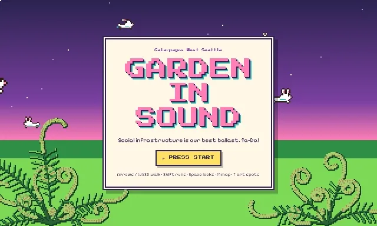

vlandham with Claude Code · 8 files, +121 −31 · ui, words & content, idea box, docs · [record](changes/2026-11-04-pr011-idea-box-optional-name-in-the-issue-and/entry.json)

---

### Nov 4, 2026 · Git workflow: who OKs shared PRs (Vince for technical, Mike for art and words) ([#10](https://github.com/gardeninsound/map/pull/10))

Clarifies rule 6 in CLAUDE.md. Shared PRs still wait for an OK, but who gives it depends on the change:

- **Technical** (Workers, CI, GitHub/Cloudflare setup, dependencies, city engine, map pipeline, CLAUDE.md dev notes) → **Vince** as tech lead. If he opened or asked for it, that's the OK.
- **Art and words** (what scenes show, Mike's lines and copy in `src/content/`, which spots and art appear) → **Mike**.

Also adds `wish/` (the idea-box Worker) to the shared list next to `relay/`.

Asked for by Vince.

vlandham with Claude Code · 1 files, +7 −2 · docs · [record](changes/2026-11-04-pr010-git-workflow-who-oks-shared-prs-vince-fo/entry.json)

---

### Nov 4, 2026 · Idea box: ideas filed by the Garden in Sound bot, not a person ([#9](https://github.com/gardeninsound/map/pull/9))

Ideas from the ✿ IDEA box are filed by a GitHub App owned by the org, so they show as **`garden-in-sound[bot]`** instead of as Vince.

vlandham with Claude Code · 6 files, +167 −14 · idea box, docs · [record](changes/2026-11-04-pr009-idea-box-ideas-filed-by-the-garden-in-so/entry.json)

---

### Nov 4, 2026 · Idea box: "What would you love to add in the Garden in Sound?" → GitHub issues ([#6](https://github.com/gardeninsound/map/pull/6))

The first half of the AI change-request flow from the hosting doc: visitors suggest, and each idea lands as a GitHub issue. No agent runs yet. That would be the `ai-build` label step later.

| before · the Junction, where everyone starts | after |
|---|---|
|  |  |

vlandham with Claude Code · 13 files, +2284 −1 · ui, words & content, idea box, docs · [record](changes/2026-11-04-pr006-idea-box-what-would-you-love-to-add-in-t/entry.json)

---

### Nov 4, 2026 · Git workflow: PRs + auto-merge, Check with smoke test, published-files test, size guard ([#5](https://github.com/gardeninsound/map/pull/5))

New standard for working in this repo, for both of us and for Claude sessions. Needs your OK, @vlandham. It changes how we both push.

**Rules** (new "Git workflow" section in CLAUDE.md)
- One short branch per feature, cut from fresh `main`; merge within a day or two
- Unfinished work merges hidden behind a switch (`ready: false`, no `experience`, a dev `?flag`) instead of living on a long branch
- Pull `main` at the start of each session
- Everything reaches `main` through a PR; never push to `main` directly
- **Feature PRs auto-merge** when the Check is green (`gh pr merge --auto --squash --delete-branch`)
- **Shared PRs wait for the other person**: `src/city/`, `App.tsx`, `relay/`, `.github/`, CLAUDE.md, dependencies, `scripts/city/`

**Check workflow** (`.github/workflows/ci.yml`) on every PR into `main`:
- **Size guard:** no added/changed file over 2 MB unless listed in `.github/large-files.txt` (the four big files already in the repo are listed)
- **Tests**, incl. new `src/content/published.test.ts`: every file the content points at (art, posters, cabinet fronts, game sounds) is in git, so nothing that only lives on one laptop 404s online. The art list is shared with `art:publish` via `scripts/neededArt.mjs`
- **Build**
- **Smoke test** (`npm run smoke`, Playwright): the built site boots with `?solo`, RECENT to the Duck Arcade, opens and closes every playable cabinet; fails on any page error, console error or 404. A missing file was checked to fail it.

After merge: protect `main` (require PRs + a green Check), so auto-merge has something to wait on.

| before · the Duck Arcade | after |
|---|---|
|  |  |

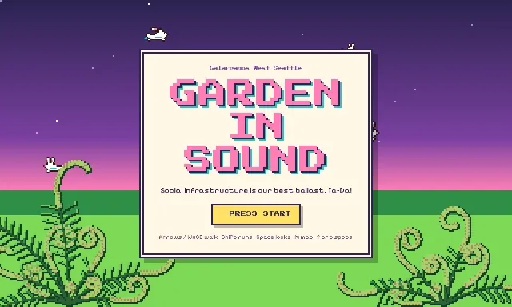

exit320-stack with Claude Code · 10 files, +316 −35 · scenes & games, words & content, ci, docs, tools · [record](changes/2026-11-04-pr005-git-workflow-prs-auto-merge-check-with-s/entry.json)

---

### Nov 4, 2026 · Relay: deployed to the gardeninsound Cloudflare account at relay.gardeninsound.website; the site uses it ([bf6cb45](https://github.com/gardeninsound/map/commit/bf6cb451c97e8cb873ff8589a32a73ea9f8d9e8b))

Co-Authored-By: Claude Opus 5.5 &lt;noreply@anthropic.com&gt;

vlandham with Claude Code · 2 files, +7 −3 · relay · [record](changes/2026-11-04-bf6cb45-relay-deployed-to-the-gardeninsound-clou/entry.json)

---

### Nov 4, 2026 · Relay: Bear Island's own copy of the arcade relay in relay/, allow-list gardeninsound.website only ([84ca634](https://github.com/gardeninsound/map/commit/84ca6344ff25929b46b82b882c41ae755cc1f386))

Co-Authored-By: Claude Opus 5.5 &lt;noreply@anthropic.com&gt;

vlandham with Claude Code · 9 files, +2023 −2 · relay, docs · [record](changes/2026-11-04-84ca634-relay-bear-islands-own-copy-of-the-arcad/entry.json)

---

### Nov 4, 2026 · Stale-deploy reload: only react to our own /assets/ files ([2e01f7e](https://github.com/gardeninsound/map/commit/2e01f7e6c5157c82ebd9cca3dbb0ae350ad8acb0))

Cloudflare injects its Web Analytics beacon; ad blockers (uBO Lite) block it, the
script-error listener took that for a stale deploy and reloaded, and main.tsx re-arms
the guard on every load — an endless reload loop. Third-party failures now don't count.

Co-Authored-By: Claude Opus 5.5 &lt;noreply@anthropic.com&gt;

vlandham with Claude Code · 1 files, +12 −1 ·  · [record](changes/2026-11-04-2e01f7e-stale-deploy-reload-only-react-to-our-ow/entry.json)

---

### Nov 4, 2026 · Merge main: gardeninsound/map at the root, live rabbits and emotes ([8b304cd](https://github.com/gardeninsound/map/commit/8b304cd72a313b7fb1b58e551ccffbb57e541f9e))

Kept both sides in App.tsx: Luna Park and the live Visitors plugin.

Co-Authored-By: Claude Opus 5.5 &lt;noreply@anthropic.com&gt;

| before · the Junction, where everyone starts | after |
|---|---|
| 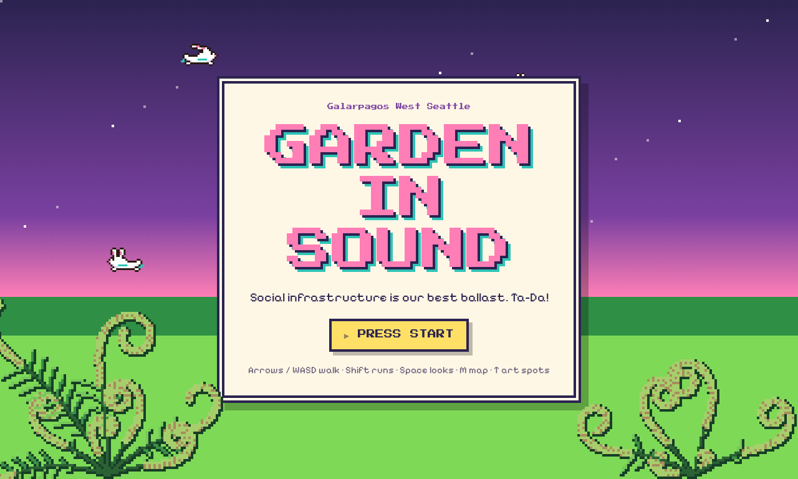 |  |

mike with Claude Code · 19 files, +1131 −25 · city, map pipeline, characters & map life, words & content, relay, docs · [record](changes/2026-11-04-8b304cd-merge-main-gardeninsoundmap-at-the-root/entry.json)

---

### Nov 4, 2026 · Duck Arcade: Duck on the Moon, Rabbit Zapper, new posters; Luna Park; game sound on ([238fcad](https://github.com/gardeninsound/map/commit/238fcad452ef5d8c3fb6b9b0f87f22f28c4548d4))

- Duck on the Moon: Pip's listening game on a paper-cut moon (three.js), sounds as MP3
- Rabbit Zapper cabinet, four more pop-art posters on the arcade walls
- Luna Park (1907-1913) on its pilings off Duwamish Head, with the Figure Eight ride
- Mini games start with their sound on even when the map is muted (not saved)

Co-Authored-By: Claude Opus 5.5 &lt;noreply@anthropic.com&gt;

| before · the Duck Arcade | after |
|---|---|
|  | 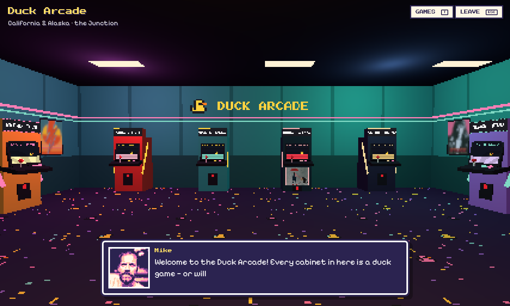 |

| before | after |
|---|---|
|  |  |

| before | after |
|---|---|
|  |  |

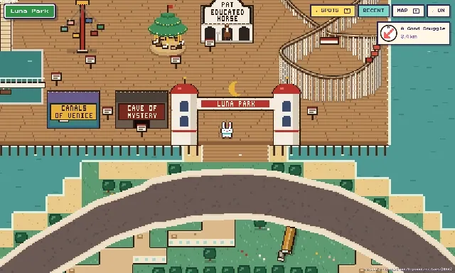

mike with Claude Code · 33 files, +3607 −8 · city, characters & map life, scenes & games, words & content, art & sound, docs · [record](changes/2026-11-04-238fcad-duck-arcade-duck-on-the-moon-rabbit-zapp/entry.json)

---

### Oct 26, 2026 · Merge chicken: Schmitz Park snuggle, Duck Arcade, Garden in Sound landmarks ([82bbc20](https://github.com/gardeninsound/map/commit/82bbc209aeeb33e5b946d67113394a46e49b895a))

Landmarks conflict: keep chicken's Safeway and West Seattle Library drawings,
add main's Shadowland sign; landmarksData + worldData regenerated (npm run map).

Co-Authored-By: Claude Opus 5.5 &lt;noreply@anthropic.com&gt;

| before · the Duck Arcade | after |
|---|---|
|  | 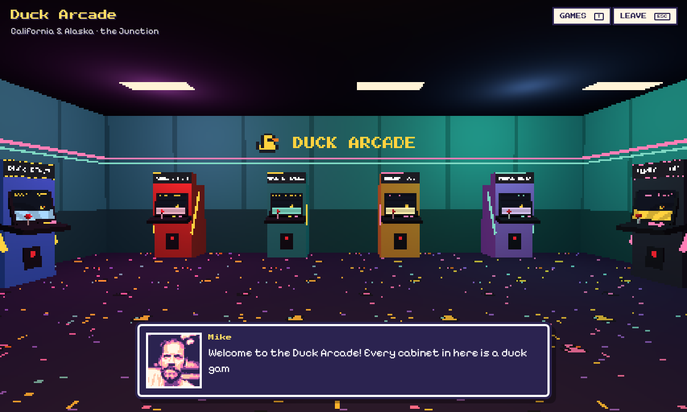 |

| before | after |
|---|---|
| 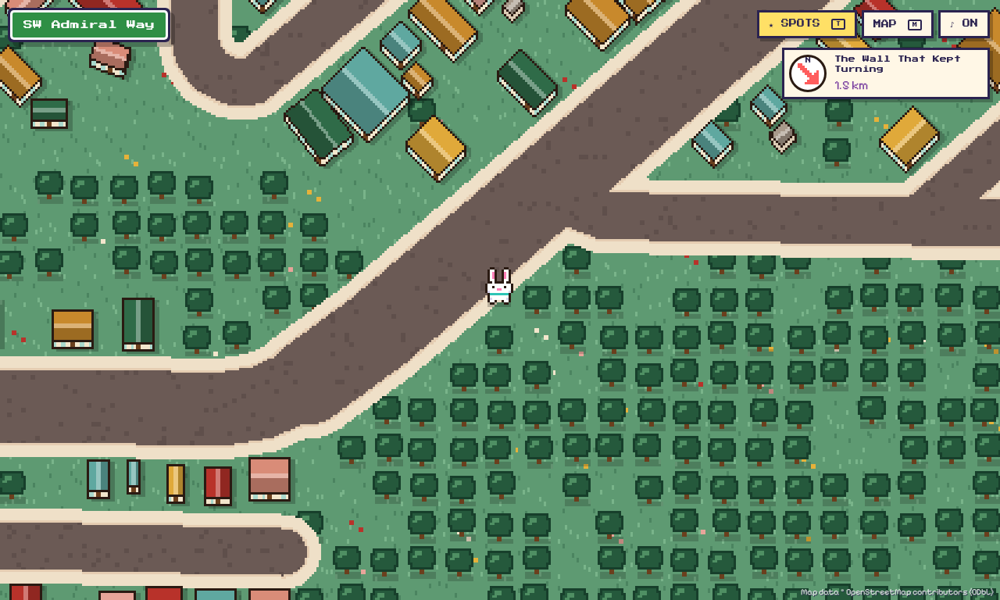 |  |

| before | after |
|---|---|
| 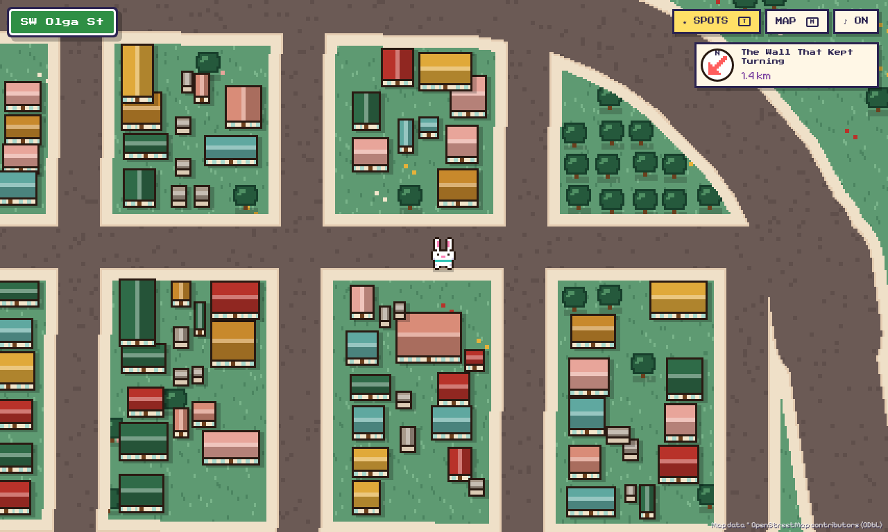 | 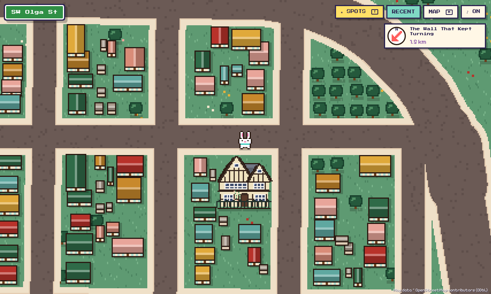 |

mike with Claude Code · 63 files, +4038 −207 · city, map pipeline, characters & map life, scenes & games, ui, words & content, art & sound, docs, tools · [record](changes/2026-10-26-82bbc20-merge-chicken-schmitz-park-snuggle-duck/entry.json)

---

### Oct 24, 2026 · Landmarks from west-seattle-map, close road holes, npm run audit ([42c7de2](https://github.com/gardeninsound/map/commit/42c7de251c8581f2aa99ae4e40c090e0d504a014))

Ported by hand from west-seattle-map (v0.3.0+):
- Landmarks: Admiral Safeway, Shadowland, West Seattle Library, each
  pulled flush with the street on its west. Map rebuilt from a fresh OSM
  fetch (otherwise 55 tiles differ, 6 houses fewer).
- Road painter fills small pockets walled in by asphalt (sidewalk scraps
  where wide streets cross, e.g. Fauntleroy & Genesee). Fixed on the way:
  the flood stopped early once a region was too big, leaving it half-seen,
  so its remainder looked enclosed and got paved in pieces (more slivers,
  not fewer); now every region floods fully, with bounds checks.
- npm run audit (scripts/city/road-audit.mjs + src/city/render/audit.ts):
  renders every chunk at ?audit, counts slivers/fragments (detailed places
  skipped), writes screenshots/audit/. 38 sidewalk-bounded slivers remain.
- Dev hook ?atTile=x,y alongside ?at=lat,lon.

Co-Authored-By: Claude Opus 5.5 &lt;noreply@anthropic.com&gt;

| before | after |
|---|---|
|  |  |

| before | after |
|---|---|
|  |  |

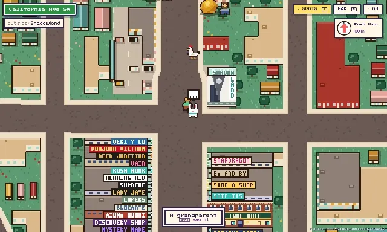

| before | after |
|---|---|
| 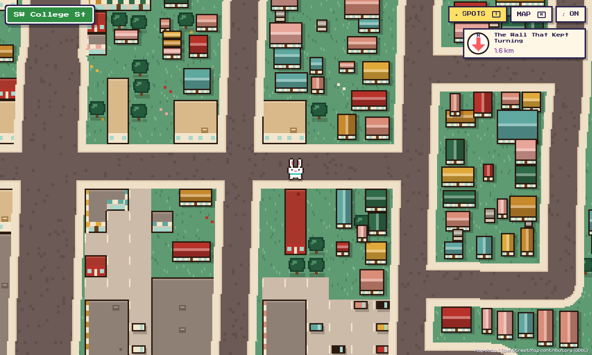 |  |

vlandham with Claude Code · 10 files, +334 −9 · city, map pipeline, docs · [record](changes/2026-10-24-42c7de2-landmarks-from-west-seattle-map-close-ro/entry.json)

---

### Oct 19, 2026 · A chicken by the vet on California, and her mini game, Cone Catch ([18e4ad0](https://github.com/gardeninsound/map/commit/18e4ad0fe026e6dc05e905fe3442321061a48eef))

- The chicken stands outside Greentree Animal Hospital (4440 California
  Ave SW), pecks and looks about. She asks two questions, two answers
  each with her reply to each, then "Want to play my mini game?"
  (lines in src/content/chicken.ts).
- Cone Catch: catch falling ice cream cones (four flavours); missed ones
  hit the grass and burst into flames. Running into a burning fire or
  taking a rock costs one of three lives; Space jumps the fires. 30 s
  rounds that speed up, best score saved. Lives in a 24 px Art Nouveau
  bar (arched medallions, whiplash vines) over the 160x120 field.
  Touch: hold lower left/right to run, tap high to jump.
- Rules are pure and tested (src/game/coneCatch.ts). App gains a
  general `minigame` overlay that hands { score, best } back to the
  character for her closing line.

Co-Authored-By: Claude Opus 5.5 &lt;noreply@anthropic.com&gt;

| before | after |
|---|---|
|  |  |

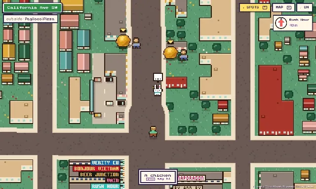

mike with Claude Code · 10 files, +880 −7 · characters & map life, scenes & games, ui, words & content, docs · [record](changes/2026-10-19-18e4ad0-a-chicken-by-the-vet-on-california-and-h/entry.json)

---

### Oct 19, 2026 · Dialog choices: arrow keys move the highlight ([4d725a6](https://github.com/gardeninsound/map/commit/4d725a6bd40008b10f7a117f5a97eaacd9e85b9b))

The arrows were kept by the game controller for walking, so only the
first choice could be picked, and it was always painted as highlighted.
Now left/right (up/down, WASD) move the selection, wrapping around; A,
Space or Enter picks it; hover selects too. The yellow highlight follows
the selection. Applies to every dialog with choices (chicken, crow, art
spots).

Co-Authored-By: Claude Opus 5.5 &lt;noreply@anthropic.com&gt;

| before · the Junction, where everyone starts | after |
|---|---|
|  |  |

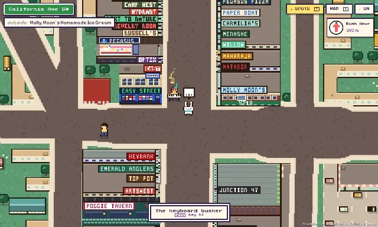

mike with Claude Code · 3 files, +101 −9 · city · [record](changes/2026-10-19-4d725a6-dialog-choices-arrow-keys-move-the-highl/entry.json)

---

### Oct 19, 2026 · Port the real-scale city onto src/city; bring the map pipeline back ([1135777](https://github.com/gardeninsound/map/commit/11357771ec63097c99d9bf472efc0e8eb66b1919))

Ports city-detail (built before the split) onto the src/city layout.

City (src/city)
- Map data regenerated by the OSM pipeline, restored as scripts/city/
  (fetch-osm, fetch-detail, landmarks, build-map, map-config) with
  npm run map / map:fetch. Proposal: upstream had made the data a frozen
  snapshot generated in west-seattle-map.
- Every public street (no alleys) on its real centreline at its real
  width x2; ~300 street names (uint16 per tile); one walkable network
- ~27k houses at true OSM size/angle; building multipolygons (25 were
  missing, including West Seattle High School)
- Landmarks: Easy Street, Undersea Aviary, 7-Eleven, the Junction block
  faces with every business + 5 shop fronts; street-side landmarks hug
  the measured sidewalk
- Detailed places (Hiawatha Playfield, West Seattle High School): lawn,
  walkable paths and parking lots, pitches/track/courts, exact outlines
- Palette from the mid-century rooms reference
- besideRoad keeps markers off buildings, lots and landmarks

Game
- Lemons replace easels (ripe = open, green = coming soon), traced from a
  photo by scripts/make-lemon.mjs; spots for the aviary and the 7-Eleven

Co-Authored-By: Claude Opus 5.5 &lt;noreply@anthropic.com&gt;

| before | after |
|---|---|
| 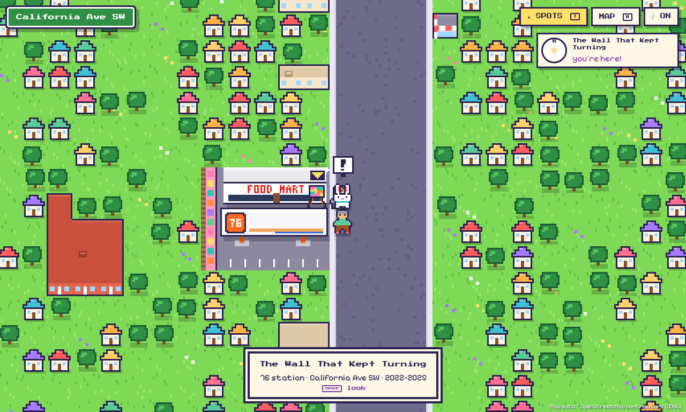 |  |

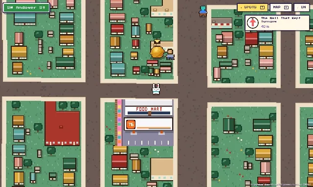

| before | after |
|---|---|
| 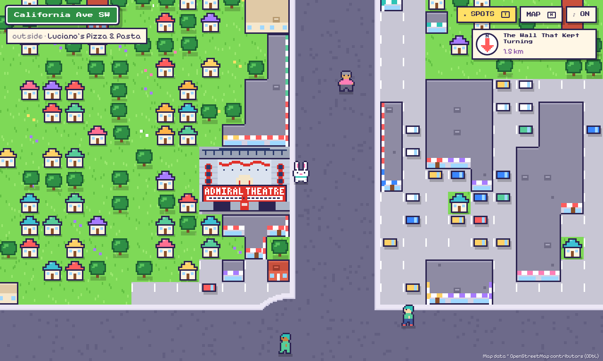 |  |

| before | after |
|---|---|
|  |  |

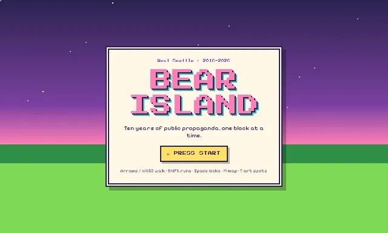

mike with Claude Code · 34 files, +2991 −146 · city, map pipeline, characters & map life, ui, words & content, docs, tools · [record](changes/2026-10-19-1135777-port-the-real-scale-city-onto-srccity-br/entry.json)

---

### Oct 18, 2026 · Disconnect from west-seattle-map: keep our own copy of the city ([d365680](https://github.com/gardeninsound/map/commit/d365680a45da6af7ad3622eb6531ca8441098265))

The city (v0.1.0) now lives in src/city/ and is maintained here; the
package dependency, the SSH deploy step and the shared sheet helper import
are gone. west-seattle-map continues as its own, separate project.

Co-Authored-By: Claude Opus 5.5 &lt;noreply@anthropic.com&gt;

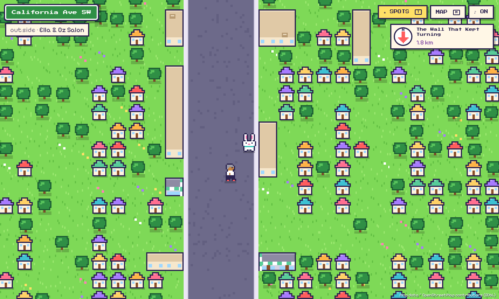

vlandham with Claude Code · 50 files, +2701 −63 · city, characters & map life, scenes & games, ui, words & content, ci, docs, tools · [record](changes/2026-10-18-d365680-disconnect-from-west-seattle-map-keep-ou/entry.json)

---

### Oct 18, 2026 · Pin west-seattle-map to v0.1.0 instead of linking the sibling folder ([872376f](https://github.com/gardeninsound/map/commit/872376ffe72ce4d1fa1f1520bb1bf31e2fe844e4))

City changes now reach Bear Island only when the tag is bumped. CI
installs the private dependency over SSH with the read-only deploy key.

Co-Authored-By: Claude Opus 5.5 &lt;noreply@anthropic.com&gt;

vlandham with Claude Code · 6 files, +25 −54 · ci, docs · [record](changes/2026-10-18-872376f-pin-west-seattle-map-to-v010-instead-of/entry.json)

---

### Oct 18, 2026 · Mike is the default speaker again, even when speaker={undefined} ([58cbd60](https://github.com/gardeninsound/map/commit/58cbd6041eccc04e734822baff92a0cfa7cfbd53))

Co-Authored-By: Claude Opus 5.5 &lt;noreply@anthropic.com&gt;

vlandham with Claude Code · 4 files, +214 −3 · ui · [record](changes/2026-10-18-58cbd60-mike-is-the-default-speaker-again-even-w/entry.json)

---

### Oct 18, 2026 · Run on west-seattle-map: the city moves to its own package ([e562d96](https://github.com/gardeninsound/map/commit/e562d968977185fcfca5886dee0b4b069547f3fd))

- Map pipeline, world, renderer, engine, neighbors, input, HUD, dialog,
  touch pad and sounds now come from ../west-seattle-map (file: dep)
- Art spots, busker and crow become CityPlugins (src/game/plugins/)
- Mike / easel / crow sprites, Mike's dialog defaults and extra sounds
  stay here; places sheet uses the shared sheet helpers
- Deploy checks out both repos (read-only deploy key for the private one)
- Esc now leaves Seven+ Stories even during its intro

Co-Authored-By: Claude Opus 5.5 &lt;noreply@anthropic.com&gt;

vlandham with Claude Code · 52 files, +684 −3667 · map pipeline, characters & map life, scenes & games, ui, words & content, ci, docs, tools · [record](changes/2026-10-18-e562d96-run-on-west-seattle-map-the-city-moves-t/entry.json)

---

### Oct 18, 2026 · Recover from stale cached pages after a deploy; defer audio ([b43fcd3](https://github.com/gardeninsound/map/commit/b43fcd3391b864c9914648d473bc1a2c4aa8c973))

- index.html: if the main script/style 404s (a cached page pointing at a
  previous deploy's files) or a scene chunk fails, reload once fresh
- Don't create the AudioContext before the first user gesture

Co-Authored-By: Claude Opus 5.5 &lt;noreply@anthropic.com&gt;

| before · the Junction, where everyone starts | after |
|---|---|
|  |  |

vlandham with Claude Code · 3 files, +33 −0 · ui · [record](changes/2026-10-18-b43fcd3-recover-from-stale-cached-pages-after-a/entry.json)

---

### Oct 18, 2026 · AVIF art pipeline + publish step; drop old WebPs ([5f0f9e7](https://github.com/gardeninsound/map/commit/5f0f9e74ca607c175d1db53fb63cc5398620000a))

- process-images: AVIF stills (1200 px) and thumbnails (320 px) from the
  originals, settings in ENCODE, stale outputs deleted, videos not re-encoded
- art:publish: stage exactly the files the scenes show (slideshow picks,
  park signs, SPOTS thumbnails) using the app's own selection code
- All art URLs go through src/content/art.ts
- Published art: 105 files / 5.3 MB (was 96 WebPs / 11.5 MB)

Co-Authored-By: Claude Opus 5.5 &lt;noreply@anthropic.com&gt;

| before · the Junction, where everyone starts | after |
|---|---|
|  |  |

vlandham with Claude Code · 213 files, +2040 −1614 · scenes & games, ui, words & content, art & sound, docs, tools · [record](changes/2026-10-18-5f0f9e7-avif-art-pipeline-publish-step-drop-old/entry.json)

---

### Oct 18, 2026 · Publish the slideshow photos (24 stills each, ~11.5 MB) ([15796d6](https://github.com/gardeninsound/map/commit/15796d631ca18765ba664770036cd2a68b879b56))

Only the stills the gas-station wall and Rush Hour slideshows show, plus
thumbnails, force-added past the public/art ignore so those scenes work
on the deployed site. The rest of the processed art stays out of git.

Co-Authored-By: Claude Opus 5.5 &lt;noreply@anthropic.com&gt;

| before · the Junction, where everyone starts | after |
|---|---|
|  |  |

vlandham with Claude Code · 97 files, +2 −1 · art & sound · [record](changes/2026-10-18-15796d6-publish-the-slideshow-photos-24-stills-e/entry.json)

---

### Oct 18, 2026 · Snack crow that flies between perches ([84646d6](https://github.com/gardeninsound/map/commit/84646d6a414cf1bf81f364ae6ab90695bab9b407))

- Perches outside Les Schwab on Alaska and asks the rabbit for snacks
  (Share a carrot / Sorry, no snacks), replies, caws, then flies over the
  rooftops to its next stop: Top Pot, Spud on Alki, Luna Park, then home
- Back at Les Schwab it remembers how many times you shared
- Stops and lines are data in src/content/crow.ts; flight state is pure
  and tested in src/game/crow.ts
- Talk overlay now takes choices and a `then` callback

Co-Authored-By: Claude Opus 5.5 &lt;noreply@anthropic.com&gt;

| before · the Junction, where everyone starts | after |
|---|---|
|  |  |

mike with Claude Code · 8 files, +372 −7 · characters & map life, ui, words & content, docs · [record](changes/2026-10-18-84646d6-snack-crow-that-flies-between-perches/entry.json)

---

### Oct 18, 2026 · Photo slideshows: 24 stills each; Rush Hour boards scene ([2376644](https://github.com/gardeninsound/map/commit/2376644aa5c21f0cf5254e2f4f80439f9a918fa4))

- Gas-station wall slideshow limited to 24 stills, evenly spread, no video
- Slideshow scene now reads a per-spot script (content/wallTurns.ts)
- Rush Hour moved to 4454 California Ave SW with its own slideshow

Co-Authored-By: Claude Opus 5.5 &lt;noreply@anthropic.com&gt;

| before | after |
|---|---|
|  |  |

vlandham with Claude Code · 6 files, +116 −22 · scenes & games, words & content · [record](changes/2026-10-18-2376644-photo-slideshows-24-stills-each-rush-hou/entry.json)

---

### Oct 18, 2026 · Paint roads per pixel from centrelines; remove corner-patch artifacts ([ce54cb8](https://github.com/gardeninsound/map/commit/ce54cb83ad525a9fd809b8fa37f5e367669cb491))

- Export road centrelines; renderer paints asphalt / curb / sidewalk by
  distance, merging crossings cleanly with round ends and bends
- Walkable road tiles use the same distance rule, so drawn = walkable
- Snap to tile centre or edge by width parity; carry a street's column
  through intersections
- Buildings drawn after roads; drop bevel/notch/nub/trim rules

Co-Authored-By: Claude Opus 5.5 &lt;noreply@anthropic.com&gt;

| before · the Junction, where everyone starts | after |
|---|---|
|  |  |

vlandham with Claude Code · 5 files, +178 −170 · characters & map life, docs, tools · [record](changes/2026-10-18-ce54cb8-paint-roads-per-pixel-from-centrelines-r/entry.json)

---

### Oct 18, 2026 · Junction busker with distance-faded chiptune music ([64e2728](https://github.com/gardeninsound/map/commit/64e2728bb61d6862674ceaf5a45ed863ba6ac5fb))

- Keyboard player on the curb outside Easy Street, rocking on the beat
  with musical notes floating up
- Three original songs synthesized via Web Audio; volume follows your
  distance and fades out past ~130 m, hushed inside art scenes, honors mute
- Talkable, with song-title chatter

Co-Authored-By: Claude Opus 5.5 &lt;noreply@anthropic.com&gt;

| before | after |
|---|---|
|  |  |

vlandham with Claude Code · 9 files, +329 −3 · characters & map life, ui, words & content, docs · [record](changes/2026-10-18-64e2728-junction-busker-with-distance-faded-chip/entry.json)

---

### Oct 18, 2026 · Compass, first-visit arrow, octilinear roads, Seven+ Stories walk ([23a878f](https://github.com/gardeninsound/map/commit/23a878f9a788dcc46da6a5519f029192835b88df))

- HUD compass points to the nearest art spot with a scene
- New visitors get a flashing arrow toward it after Mike's welcome
- Roads snapped to 0/45/90° with half-tile curb cuts: clean diagonals
- Seven+ Stories: first-person three.js walk of the lot at
  4731 40th Ave SW, signs standing in the field, close-up reading

Co-Authored-By: Claude Opus 5.5 &lt;noreply@anthropic.com&gt;

| before | after |
|---|---|
| 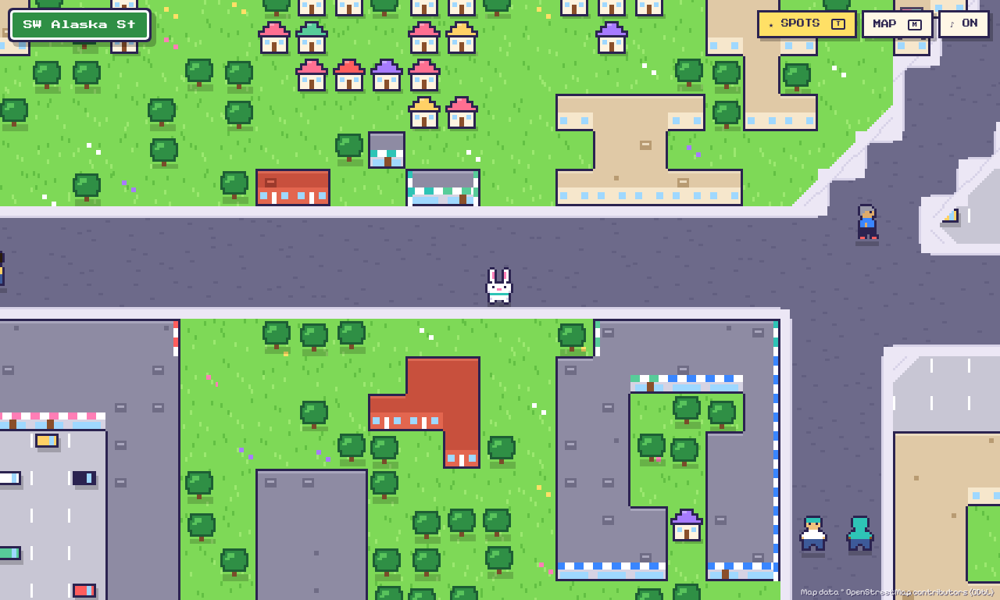 | 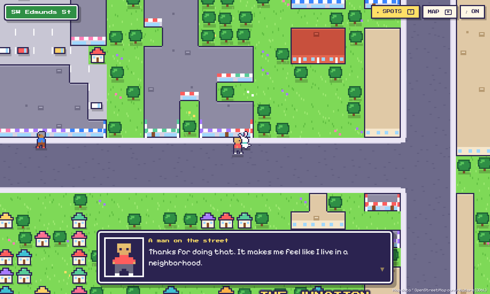 |

vlandham with Claude Code · 18 files, +960 −34 · characters & map life, scenes & games, ui, words & content, docs, tools · [record](changes/2026-10-18-23a878f-compass-first-visit-arrow-octilinear-roa/entry.json)

---

### Oct 18, 2026 · Wider, straighter roads with clean intersections ([14bb1a4](https://github.com/gardeninsound/map/commit/14bb1a4d1a6a36ef02174eec5326e5191056e0b3))

- California 4 tiles, other streets 3; diagonals widened to match
- Chain each street's OSM ways, cut at intersections, snap near-axis
  runs to tile centres so straight streets stay straight
- Drop turn ramps and short unnamed stubs; report unreachable streets
- 45° curb cuts at corners and staircase notches
- More review spots (Erskine Way, California & Admiral)

Co-Authored-By: Claude Opus 5.5 &lt;noreply@anthropic.com&gt;

| before · the Junction, where everyone starts | after |
|---|---|
|  |  |

vlandham with Claude Code · 6 files, +198 −23 · characters & map life, docs, tools · [record](changes/2026-10-18-14bb1a4-wider-straighter-roads-with-clean-inters/entry.json)

---

### Oct 18, 2026 · Map cleanup, landmarks, and art-spot shortcuts ([23e2785](https://github.com/gardeninsound/map/commit/23e2785b557389db7f90d6f38ece8204a568145a))

- Roads: one fixed width per street (scripts/map-config.mjs), simplified
  polylines, constant-width bands; arterials 2 tiles to match 12 m lots
- Sidewalks drawn on road edge tiles so they're identical everywhere
- Landmarks sheet (content/landmarks.csv) geocoded and placed beside the
  street: 76 station with the mural wall, Admiral Theatre
- Gas-station wall spot moved to the 76 at 4001 California Ave SW
- SPOTS menu (T): jump to any art spot or straight into its scene
- npm run map:review: repeatable before/after map screenshots

Co-Authored-By: Claude Opus 5.5 &lt;noreply@anthropic.com&gt;

| before | after |
|---|---|
|  |  |

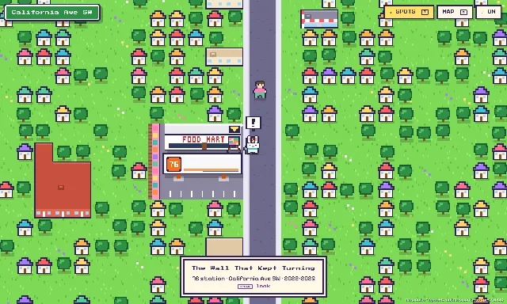

| before | after |
|---|---|
|  |  |

vlandham with Claude Code · 24 files, +704 −85 · map pipeline, characters & map life, ui, words & content, docs, tools · [record](changes/2026-10-18-23e2785-map-cleanup-landmarks-and-art-spot-short/entry.json)

---

### Oct 18, 2026 · Bear Island map: pixel West Seattle overworld with first art scenes ([8066597](https://github.com/gardeninsound/map/commit/806659730c751aabf719c285a3b732ad3c7af377))

- OSM-generated West Seattle (12 m tiles): real streets, footprint houses,
  storefronts, parks with labels; walkable arterials incl. bridges
- Rabbit avatar, wandering neighbors, Mike dialog, minimap, touch controls
- Art spots from content/places.csv (geocoded via Nominatim)
- Scenes: gas-station wall flipbook, 3D paintable Lulu cup (three.js)
- Processed art kept out of git; regenerate with npm run images

Co-Authored-By: Claude Opus 5.5 &lt;noreply@anthropic.com&gt;

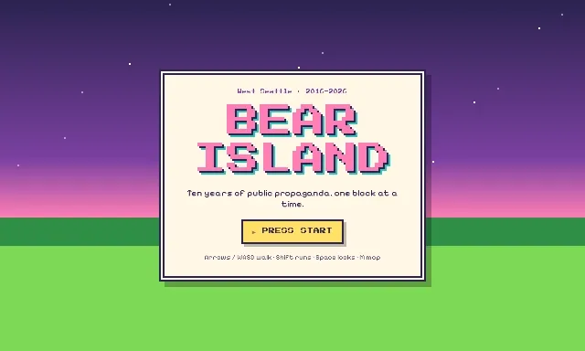

vlandham with Claude Code · 57 files, +12643 −0 · characters & map life, scenes & games, ui, words & content, art & sound, ci, docs, tools · [record](changes/2026-10-18-8066597-bear-island-map-pixel-west-seattle-overw/entry.json)

---

## Wishes still waiting

- Nov 4, 2026: “some little hats the rabits could wear and mini version of us and mst3k people walking around who we could talk to” — zia vallandingham jims kid ([#34](https://github.com/gardeninsound/map/issues/34))
