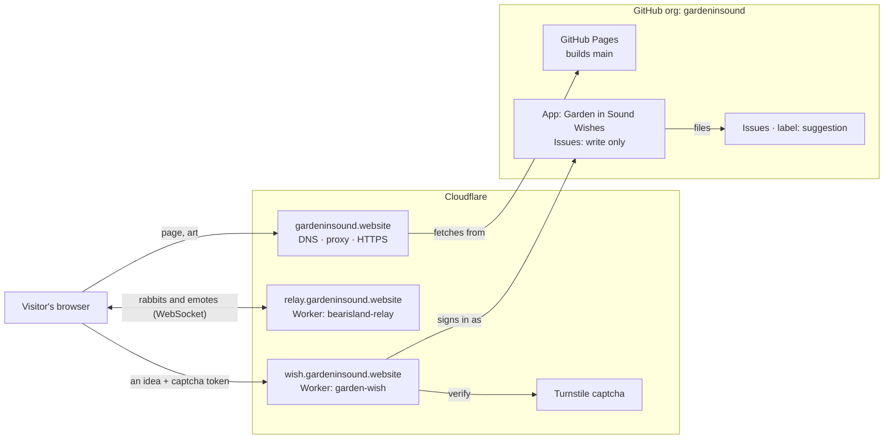

# How Garden in Sound is hosted

The map is live at **https://gardeninsound.website**. This page covers what runs where, how a
change goes live, and the jobs that come up. For how the code fits together, see
[`CLAUDE.md`](../CLAUDE.md).

Everything runs on free plans.

## What's running

| Piece | Address | Runs on | Code |
|---|---|---|---|
| The map site | `gardeninsound.website` | GitHub Pages, behind Cloudflare's proxy | this repo (`src/`) |
| Rabbits relay | `relay.gardeninsound.website` | Cloudflare Worker `bearisland-relay` | [`relay/`](../relay) |
| Idea box | `wish.gardeninsound.website` | Cloudflare Worker `garden-wish` | [`wish/`](../wish) |
| Captcha | — | Cloudflare Turnstile | used by `src/ui/IdeaBox.tsx` + `wish/` |
| Idea author | `garden-in-sound-wishes[bot]` | GitHub App "Garden in Sound Wishes" | used by `wish/src/githubApp.ts` |

The repo belongs to the [`gardeninsound`](https://github.com/gardeninsound) GitHub org. The
domain, DNS and both Workers are in the project's Cloudflare account. Mike (the artist) and Jim
(tech lead) look after both.

## How a change goes live

`main` is always live. The full rules are in the **Git workflow** section of
[`CLAUDE.md`](../CLAUDE.md#git-workflow-everyone-claude-included). In short:

1. Make a short branch from fresh `main`, then open a pull request.
2. The **Check** workflow runs: a size guard (no file over 2 MB unless listed in
   `.github/large-files.txt`), `npm test`, `npm run build`, and `npm run smoke` (the built site
   in a real browser).
3. Every PR auto-merges (squash) the moment the Check passes; nobody waits for an OK. A PR that
   touches the other person's area adds them as a reviewer, as a heads-up: **Jim** for technical
   changes, **Mike** for the art and the words.
4. GitHub Pages deploys the site in about a minute.
5. **The Workers don't deploy themselves.** After a merge that changes `relay/` or `wish/`, run
   `npx wrangler deploy` in that folder from `main`. Each `wrangler.jsonc` pins the project's
   Cloudflare account, so a deploy can't land anywhere else.

Each Worker also has an end-to-end test that runs locally, not in the Check:
`cd relay && npm test` and `cd wish && npm test`.

## The relay: other rabbits, live

Each visitor keeps one WebSocket open to the relay, which forwards positions and emotes to
everyone else in the room. It stores nothing. It only accepts connections from
`gardeninsound.website`, `www.gardeninsound.website` and localhost, and allows at most 64
rabbits in a room. Rabbits only send while they move, at most 5 times a second, because the
free plan is metered by messages.

| When a visitor… | their rabbit, for everyone else | "other rabbits" count |
|---|---|---|
| closes the tab or leaves the site | disappears at once | drops |
| opens a scene, a menu or the idea box | fades | still counted |
| switches tabs or apps | fades at once | still counted |
| stays hidden for 2 minutes | leaves the room | drops |
| goes 10 minutes without keys, mouse or taps | fades | still counted |
| goes 30 minutes without input | leaves the room | drops |
| comes back (shows the tab, or any input) | returns as the same rabbit, with the same name | back up |
| closes the laptop, or the phone kills the browser | the relay drops it after ~90 s of silence | drops |

The rules live in `presence()` in `src/game/visitors.ts`. While anyone is connected, the relay
checks every 30 seconds for connections that have been silent (no messages, no keep-alive ping)
for 90 seconds, and closes them. To try the timings quickly, run `npm run dev` and add
`?presence=2` to the URL: a rabbit fades after 2 s hidden, after 4 s idle, and leaves after 8 s.

## The idea box

**✿ IDEA** in the map's top bar asks *"What would you love to add in the Garden in Sound?"*. The
box has the idea, an optional name and a captcha. Each idea becomes an issue in this repo,
labelled [`suggestion`](https://github.com/gardeninsound/map/issues?q=label%3Asuggestion) and
written by `garden-in-sound-wishes[bot]`. If a name was given, it's credited in the issue. The
box tells visitors that ideas are public.

The Worker checks, in order:

1. the page's origin (the site or localhost only);
2. the text: 5–1000 characters, and a name of at most 60;
3. at most 3 ideas a minute from one address (only well-formed ones count);
4. the Turnstile token, to confirm a person sent it.

It then signs in as the GitHub App, which can only write issues, and files the idea.
`@mentions` and Markdown in the visitor's text are defused. The text is only ever stored as the
issue's body, never run.

## Secrets

There are two, both stored as encrypted Worker secrets on `garden-wish`. Neither is in the repo.

| Secret | What it is | To replace it |
|---|---|---|
| `TURNSTILE_SECRET` | the server half of the captcha | rotate it on the Turnstile widget in Cloudflare, then run `npx wrangler secret put TURNSTILE_SECRET` in `wish/` |
| `GITHUB_APP_KEY` | the GitHub App's private key, in PKCS#8 format | on the app's settings page, choose **Generate a private key**. Convert it with `openssl pkcs8 -topk8 -nocrypt -in key.pem`, run `npx wrangler secret put GITHUB_APP_KEY`, then delete the old key on GitHub |

These are public by design and live in code: the Turnstile site key (`src/content/ideas.ts`), the
app and installation ids (`wish/wrangler.jsonc`), and the Cloudflare account id (both
`wrangler.jsonc` files).

## Common jobs

| Job | How |
|---|---|
| Deploy the site | Merge a PR into `main`. |
| Deploy a Worker | From `main`, run `cd relay && npx wrangler deploy` (or the same in `wish/`). You need a wrangler login (`npx wrangler login`) as a member of the project's Cloudflare account. |
| Let another site use the relay or the idea box | Add its origin to `ALLOWED_ORIGINS` in that Worker's `wrangler.jsonc`, then open a PR, merge it, and deploy. |
| Change DNS | Cloudflare → `gardeninsound.website` → DNS. Keep the records pointing to GitHub proxied, and keep SSL/TLS on **Full** (see the gotchas below). |
| A replaced art file still shows the old version | Cloudflare → Caching → Configuration → **Purge Everything**. Code never needs this: every build gets new file names. |
| Read the ideas | [Issues labelled `suggestion`](https://github.com/gardeninsound/map/issues?q=label%3Asuggestion) |
| Watch a Worker's logs | `npx wrangler tail` in `relay/` or `wish/` |
| Move the map to `gardeninsound.website/map/` | Set `base: '/map/'` in `vite.config.ts` and remove `public/CNAME`. Then give the domain to a `gardeninsound.github.io` repo in the org. Every asset URL already goes through `BASE_URL`. |

## Gotchas

- **Cloudflare error 526 ("Invalid SSL certificate").** Behind the proxy, GitHub serves its
  generic `*.github.io` certificate, which SSL mode **Full (strict)** rejects. Use **Full**.
- **Ad blockers and Cloudflare's analytics script.** Cloudflare adds a Web Analytics script to
  every page, and ad blockers block it. The site reloads once when one of its own files is
  missing (a stale cached page after a deploy). That reload ignores anything that isn't from the
  site's own `/assets/`, so blocked third-party scripts can't cause a reload loop.
- **The captcha blocks automated browsers.** That's by design. Testing the live idea box end to
  end takes a person; locally, `?wish=http://127.0.0.1:8791` and Turnstile's test key let you
  script it.
- **Saved progress is per domain.** Visited spots, best scores and the hide-rabbits setting live
  in the visitor's browser. Changing domains resets them; moving to a path on the same domain
  doesn't.
- **GitHub Pages doesn't redirect when a repo moves or is renamed.** The old address stops working
  straight away.
